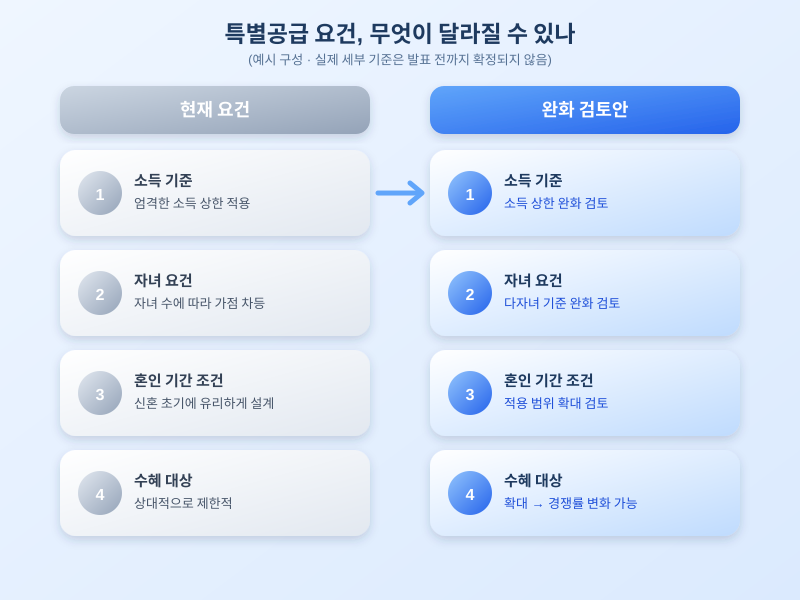

# 신혼부부·다자녀 특별공급 요건 완화 논의, 청약 전략 달라지나

  

연말이 가까워지면서 내년도 청약 계획을 세우는 분들이라면 한 번쯤 들어봤을 소식이 있습니다. 바로 신혼부부와 다자녀 가구를 위한 특별공급 자격 요건을 완화하는 방안이 다시 논의되고 있다는 소식인데요. 결혼이나 출산을 앞두고 있거나 이미 자녀를 키우며 내 집 마련을 고민하는 가구라면, 요건이 어떻게 바뀔 수 있는지 미리 흐름을 파악해두는 것이 유리합니다.

특별공급은 일반공급과 별도로 신혼부부, 다자녀, 노부모 부양 등 정책적으로 배려가 필요한 계층에게 청약 기회를 우선 배분하는 제도입니다. 다만 소득 기준과 자산 기준이 비교적 엄격하게 적용되고, 혼인 기간이나 자녀 수 조건도 세밀하게 나뉘어 있어 실제로는 신청 자체가 까다롭다는 지적이 꾸준히 있었습니다. 이번에 논의되는 완화안은 소득 상한을 일부 넓히고, 다자녀 인정 기준이나 혼인 기간 적용 범위를 손보는 방향으로 알려져 있습니다.

  

요건이 실제로 완화된다면 가장 먼저 눈에 띄는 변화는 신청 가능한 가구의 범위가 넓어진다는 점입니다. 지금까지는 소득이나 자산 기준을 살짝 넘겨 특별공급 신청 자체를 포기했던 가구도 새로 자격을 갖추게 될 수 있습니다. 다만 신청 가능 인원이 늘어나는 만큼 인기 단지에서는 경쟁률이 오히려 높아질 가능성도 함께 고려해야 합니다. 자격이 넓어지는 것과 당첨 가능성이 높아지는 것은 다른 이야기라는 점을 기억해둘 필요가 있습니다.

청약을 준비하고 있다면 지금부터 챙겨둘 점들이 있습니다. 먼저 현재 자신의 소득·자산이 기존 기준과 완화 검토안 기준 양쪽에서 각각 어디에 위치하는지 미리 계산해보는 것이 좋습니다. 또한 혼인 기간이나 자녀 수처럼 시간이 지나야 채워지는 조건이 있다면, 청약 시점을 조정하는 것이 유리할지도 함께 따져보시길 권합니다. 세부 기준은 아직 확정되지 않았으므로, 공식 발표가 나오기 전까지는 여러 시나리오를 열어두고 준비하는 자세가 필요합니다.

특별공급 요건 완화는 내 집 마련의 문턱을 낮춰주는 반가운 소식이지만, 동시에 경쟁 구도를 바꿔놓을 수 있는 변수이기도 합니다. 청약을 앞두고 있다면 확정 발표가 나오는 시점을 놓치지 말고, 자신의 상황에 맞는 전략을 미리 그려보시길 바랍니다.

※ 이 초안은 AI가 생성했습니다. 게시 전 수치·정책 내용의 사실관계를 반드시 확인하세요.
