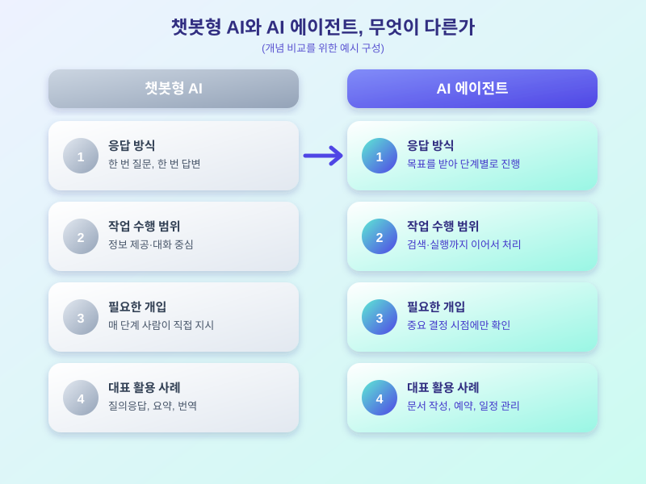

# AI 에이전트 활용 확산, 일상과 업무는 어떻게 달라지고 있나

  

요즘 'AI 에이전트'라는 말을 전보다 훨씬 자주 듣게 됩니다. 질문을 던지면 답을 내놓던 기존 챗봇형 AI를 넘어, 스스로 계획을 세우고 여러 단계의 작업을 이어서 처리하는 형태의 AI가 기업 업무와 일상 서비스 전반으로 빠르게 퍼지고 있는데요. 아직 낯설게 느껴질 수 있지만, 이미 메일 정리나 예약, 자료 검색 같은 일에서 조금씩 활용되고 있는 만큼 전체적인 흐름을 짚어볼 필요가 있습니다.

기존 챗봇형 AI는 한 번의 질문에 한 번의 답을 돌려주는 방식이 기본이었습니다. 반면 AI 에이전트는 하나의 목표를 받으면 이를 여러 하위 작업으로 나누고, 필요한 정보를 스스로 찾아보거나 다른 프로그램을 호출하면서 순차적으로 일을 완결 짓는다는 점이 다릅니다. 즉 '대화 상대'에서 '일을 대신 처리해주는 보조자'로 역할이 확장되는 셈입니다.

  

기업 현장에서는 반복적인 문서 작업이나 고객 응대 업무에 AI 에이전트를 붙여, 담당자가 전체 과정을 일일이 챙기지 않아도 초안 작성이나 1차 응대까지는 자동으로 진행되도록 하는 시도가 늘고 있습니다. 개인 영역에서도 일정 조율, 간단한 쇼핑이나 예약처럼 여러 단계를 거쳐야 하는 일을 AI 에이전트에 맡기는 서비스가 하나둘 자리를 잡아가는 중입니다.

다만 편리함만큼 주의도 필요합니다. AI 에이전트가 내린 판단이나 처리 결과를 그대로 믿기보다는 중요한 결정 앞에서는 한 번 더 확인하는 습관이 필요하고, 결제나 개인정보 접근처럼 민감한 권한을 어디까지 맡길지도 이용자가 직접 정해두어야 합니다. 편의성과 통제권 사이에서 자신에게 맞는 균형점을 찾는 것이 결국 핵심입니다.

AI 에이전트의 확산은 당장 눈에 보이는 변화라기보다, 업무와 일상 곳곳에서 조용히 쌓여가는 변화에 가깝습니다. 낯설다고 멀리하기보다는 작은 영역부터 직접 경험해보면서 나에게 맞는 활용법을 찾아가는 것이 지금 시점에서는 가장 현실적인 접근일 듯합니다.

※ 이 초안은 AI가 생성했습니다. 게시 전 수치·정책 내용의 사실관계를 반드시 확인하세요.
