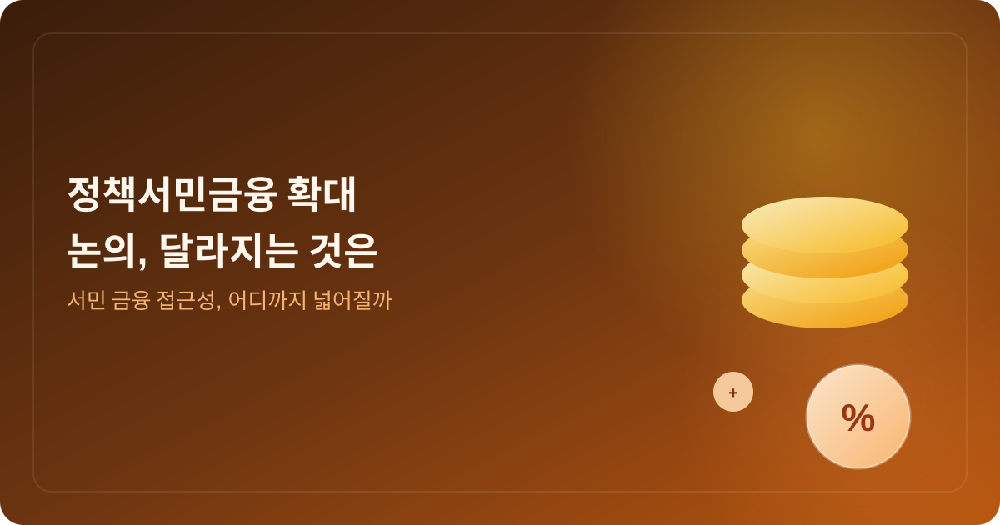
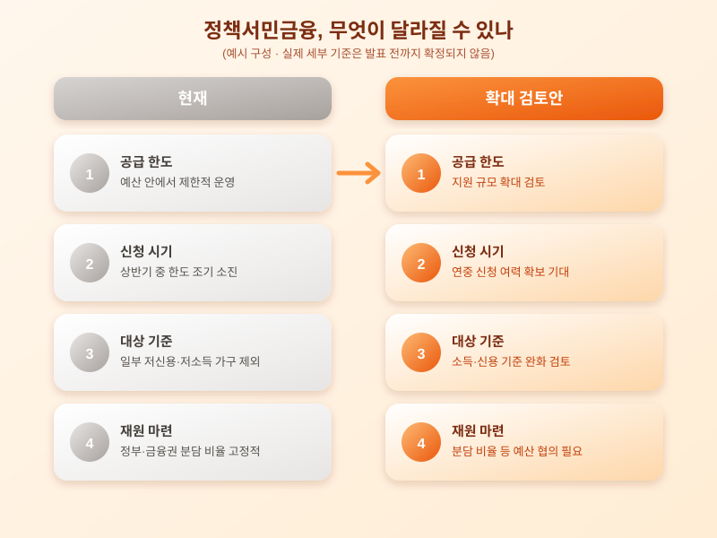

# 정책서민금융(햇살론 등) 확대 논의, 서민 금융 접근성 달라지나

  

연말로 접어들면서 내년도 예산안을 짜는 시기가 돌아왔습니다. 그 가운데 눈에 띄는 논의 중 하나가 바로 정책서민금융, 흔히 '햇살론'이나 '새희망홀씨'로 알려진 서민 대상 저금리 대출 상품의 지원 규모를 늘리는 방안입니다. 제도권 은행에서 대출받기 어려운 저신용·저소득층의 금융 접근성을 어떻게 넓힐지가 다시 화두로 떠오른 셈인데요, 자금이 필요한 서민 입장에서는 꼭 챙겨봐야 할 소식입니다.

정책서민금융은 신용도가 낮거나 소득이 일정 수준 이하인 사람들이 제도권 금융에서 밀려나 고금리 대출로 떠밀리지 않도록, 정부가 보증을 서거나 재원을 지원해 상대적으로 낮은 금리로 돈을 빌릴 수 있게 해주는 제도입니다. 다만 매년 정해진 예산과 공급 한도 안에서 운영되다 보니, 신청이 몰리는 시기에는 한도가 일찍 소진돼 발길을 돌려야 하는 경우도 적지 않았습니다. 이번 확대 논의는 바로 이런 '공급 부족' 문제를 풀어보려는 시도로 읽힙니다.

  

실제로 지원 규모가 늘어난다면 가장 먼저 기대할 수 있는 변화는 신청 가능 시기와 한도의 여유입니다. 지금까지는 상반기에 한도가 조기 소진되면서 하반기에는 사실상 신청이 막히는 경우가 흔했는데, 공급이 늘면 이런 '조기 마감' 부담이 줄어들 수 있습니다. 또한 소득이나 신용점수 기준이 함께 손질될 경우, 기존에는 지원 대상에서 아쉽게 벗어났던 가구도 새롭게 자격을 갖추게 될 가능성이 있습니다.

다만 확대 논의가 곧바로 결정으로 이어지는 것은 아니라는 점은 유의해야 합니다. 예산 편성 과정에서 다른 복지·금융 지원 사업과 우선순위를 다퉈야 하고, 재원 마련 방식(정부 재정 투입 비율, 금융권 분담 비율 등)을 둘러싼 협의도 필요합니다. 정책서민금융 이용을 고려하고 있다면 공식 발표 전까지는 현재 운영 중인 상품의 한도와 조건을 먼저 확인해보고, 자금이 급하다면 분할 신청이나 대체 상품도 함께 알아보는 것이 안전합니다.

서민금융 지원 확대는 당장 모두에게 혜택이 돌아가는 소식은 아니지만, 제도권 금융 밖으로 밀려날 뻔했던 이들에게는 적지 않은 의미를 갖는 변화입니다. 관련 자금이 필요하신 분이라면 이번 논의가 어떻게 구체화되는지 꾸준히 지켜보시고, 확정 발표 시점에 맞춰 발빠르게 움직이시길 바랍니다.

※ 이 초안은 AI가 생성했습니다. 게시 전 수치·정책 내용의 사실관계를 반드시 확인하세요.
