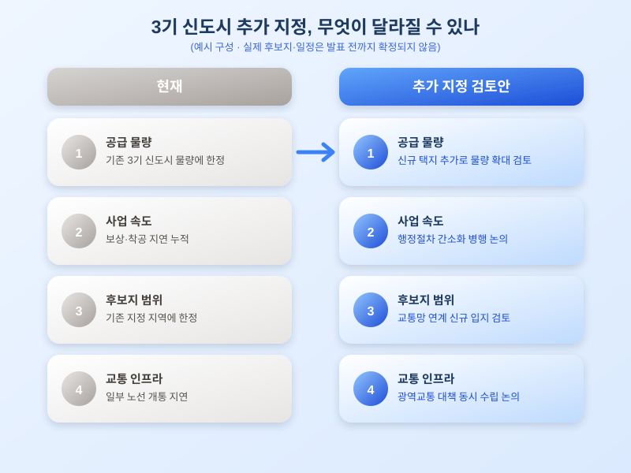

# 수도권 공급 부족 해소 위한 3기 신도시 추가 지정 논의, 어디가 유력할까

  

수도권 집값 상승세가 쉽게 꺾이지 않으면서, 정부가 추가 공급 카드로 '3기 신도시 추가 지정'을 검토하고 있다는 소식이 다시 주목받고 있습니다. 기존 3기 신도시만으로는 공급 부족을 해소하기 어렵다는 지적이 누적된 가운데, 신규 택지를 더 늘려야 한다는 목소리가 커지는 시점인데요, 내 집 마련을 계획 중인 분이라면 눈여겨볼 만한 흐름입니다.

사실 3기 신도시는 이미 여러 곳에서 추진 중이지만, 보상 협의나 행정 절차가 예상보다 더디게 진행되면서 당초 계획한 입주 시점이 늦춰진 사례가 적지 않았습니다. 이런 상황에서 수도권 전세·매매 시장 불안이 반복되자, 기존 물량만으로는 역부족이라는 공감대가 형성되며 추가 택지 지정 논의가 다시 떠오른 것으로 보입니다. 즉 이번 논의는 완전히 새로운 정책이라기보다, 공급 속도와 물량을 둘러싼 기존 고민이 이어진 결과라고 볼 수 있습니다.

  

추가 지정이 실제로 이뤄진다면 가장 먼저 주목할 부분은 후보지 선정 기준입니다. 단순히 유휴 부지를 찾는 것을 넘어, 기존 광역교통망과 연계할 수 있는지, 자족 기능(일자리, 상업시설 등)을 갖출 수 있는지가 함께 고려될 것으로 예상됩니다. 교통 대책 없이 주택만 먼저 짓는 방식은 기존 신도시에서도 반복적으로 문제가 됐던 만큼, 이번에는 광역교통 대책을 동시에 마련하는 방향으로 논의가 이뤄질 가능성이 있습니다.

다만 후보지가 특정되고 실제 지정까지 이어지는 데는 상당한 시간이 걸릴 수 있다는 점은 유의해야 합니다. 토지 보상, 환경영향평가, 지방자치단체와의 협의 등 거쳐야 할 절차가 많고, 이 과정에서 후보지가 바뀌거나 계획이 조정되는 경우도 흔합니다. 따라서 당장 특정 지역을 염두에 두고 움직이기보다는, 공식 발표가 나올 때까지 공급 계획의 큰 흐름과 교통 대책 방향을 함께 지켜보는 편이 안전합니다.

수도권 추가 공급 논의는 하루아침에 결론이 날 사안은 아니지만, 중장기적으로 내 집 마련 전략을 세우는 데 중요한 변수가 될 수 있습니다. 관심 있는 지역이 있다면 이번 논의가 구체화되는 과정을 꾸준히 살펴보시고, 공식 발표 이후 세부 조건을 꼼꼼히 비교해 움직이시길 바랍니다.

※ 이 초안은 AI가 생성했습니다. 게시 전 수치·정책 내용의 사실관계를 반드시 확인하세요.
