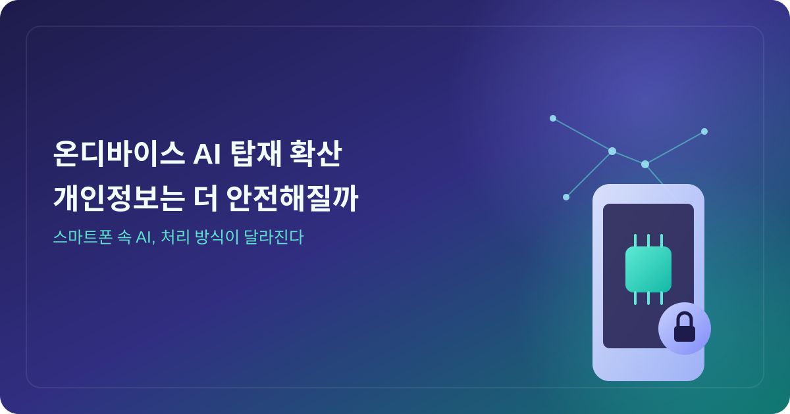
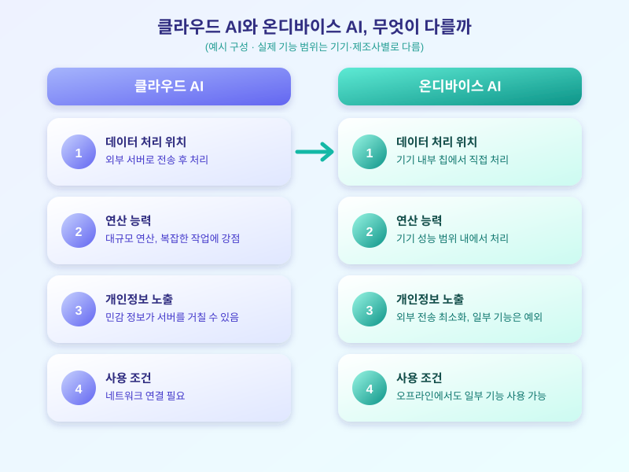

# 온디바이스 AI 탑재 스마트폰 확산, 개인정보는 더 안전해질까

  

최근 스마트폰 제조사들이 기기 자체에서 AI 연산을 처리하는 '온디바이스 AI' 탑재를 빠르게 늘려가고 있습니다. 질문이나 사진, 음성 데이터를 외부 서버로 보내지 않고 기기 안에서 바로 처리한다는 점이 부각되면서, 개인정보 보호 측면에서 어떤 변화가 생길지에 관심이 모이고 있습니다.

기존에 널리 쓰이던 AI 서비스는 사용자의 질문이나 사진, 음성 등을 서버로 전송한 뒤 처리 결과를 다시 받아오는 방식이 많았습니다. 이 방식은 강력한 연산 능력을 활용할 수 있다는 장점이 있지만, 민감한 개인 정보가 외부 서버를 거친다는 점에서 불안감을 느끼는 사용자도 적지 않았습니다. 온디바이스 AI는 이런 우려를 줄이기 위해 등장한 접근 방식으로, 문자 요약이나 사진 분류, 음성 명령 처리 같은 기능 일부를 기기 내부의 칩에서 직접 처리합니다.

  

다만 온디바이스 AI가 개인정보 문제를 전부 해결해 주는 만능 해법은 아닙니다. 기기 안에서 처리된다고 해도 앱 자체가 수집하는 정보가 있을 수 있고, 일부 고급 기능은 여전히 서버와 통신해야 동작하는 경우도 있기 때문입니다. 또한 온디바이스 처리는 기기의 성능과 배터리 소모에도 영향을 줄 수 있어, 제조사들은 어떤 기능을 기기 안에서 처리하고 어떤 기능을 서버로 보낼지 그 균형을 계속 조정해 나가는 중입니다. 결국 '온디바이스'라는 표현만으로 안전성을 단정하기보다, 실제로 어떤 데이터가 어디까지 기기 밖으로 나가는지를 살펴보는 자세가 더 중요합니다.

스마트폰을 사용하는 입장에서는 설정 메뉴에서 AI 기능이 어떤 권한을 요구하는지, 처리 결과가 기기 내부에만 저장되는지 아니면 서버로도 전송되는지를 한 번쯤 확인해 보는 습관이 필요합니다. 온디바이스 AI는 분명 개인정보 보호를 강화하는 방향으로 나아가고 있지만, 그 실질적인 안전성은 제조사의 구현 방식과 사용자 스스로의 설정에 따라 달라질 수 있다는 점을 기억해 두면 좋겠습니다.

※ 이 초안은 AI가 생성했습니다. 게시 전 수치·정책 내용의 사실관계를 반드시 확인하세요.
