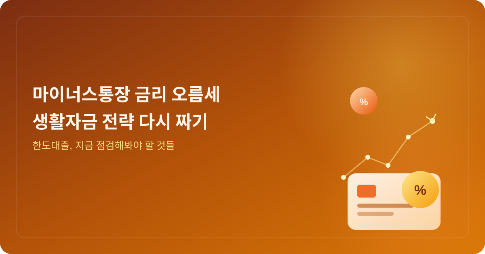
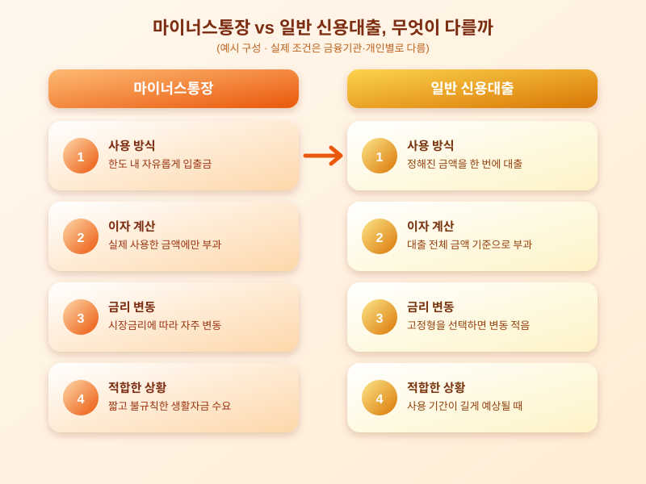

# 마이너스통장(한도대출) 금리 오름세, 생활자금 대출 전략 다시 짜야 할까

  

최근 들어 마이너스통장, 즉 한도대출의 금리가 조금씩 오름세를 보인다는 이야기가 심심치 않게 들립니다. 급할 때 필요한 만큼만 빌려 쓰고 쓴 만큼만 이자를 낸다는 편리함 때문에 생활자금 창구로 마이너스통장을 활용해 온 분들이라면, 이번 금리 움직임이 앞으로의 자금 계획에 어떤 영향을 줄지 궁금해질 시점입니다.

마이너스통장은 정해진 한도 안에서 자유롭게 입출금하며 사용한 금액에 대해서만 이자가 붙는 구조입니다. 급여가 들어오기 전 생활비가 부족할 때나 예상치 못한 지출이 생겼을 때 요긴하게 쓰이지만, 금리가 시장 상황에 따라 변동되는 상품이라는 점은 꼭 기억해야 합니다. 시장금리가 오름세를 보이면 마이너스통장 금리도 함께 움직이기 쉽고, 이는 평소 한도를 자주 활용하던 사람일수록 체감하는 이자 부담이 커질 수 있다는 뜻입니다.

  

이런 시기에는 마이너스통장 외에 다른 대출 방식과 비교해보는 습관이 도움이 됩니다. 정해진 금액을 한 번에 빌려 정해진 기간 동안 상환하는 일반 신용대출은 금리가 고정되는 경우가 많아, 사용 기간이 길어질 것으로 예상된다면 오히려 유리할 수 있습니다. 반대로 사용 시점과 금액이 불규칙하고 짧은 기간만 활용할 생활자금이라면, 금리 변동을 감안하더라도 마이너스통장의 유연함이 여전히 매력적일 수 있습니다. 결국 어떤 방식이 더 유리한지는 각자의 자금 사용 패턴과 예상 사용 기간에 따라 달라집니다.

마이너스통장을 이미 쓰고 있다면 현재 적용받는 금리와 한도를 다시 한번 점검하고, 불필요하게 한도를 깔아두고만 있는 것은 아닌지 살펴보는 것도 좋습니다. 또한 여러 금융기관의 조건을 함께 비교해보면 생각보다 더 유리한 조건을 찾을 수도 있습니다. 금리가 오르는 시기일수록 작은 차이가 쌓여 전체 이자 부담에 영향을 주는 만큼, 지금이야말로 자신의 생활자금 대출 전략을 한 번 점검해볼 좋은 시점이 아닐까 합니다.

※ 이 초안은 AI가 생성했습니다. 게시 전 수치·정책 내용의 사실관계를 반드시 확인하세요.
