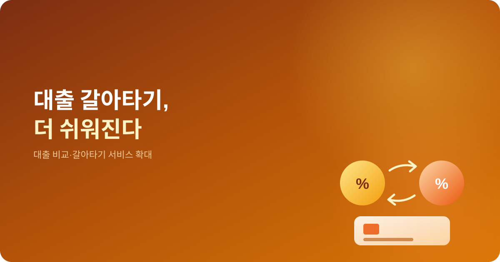
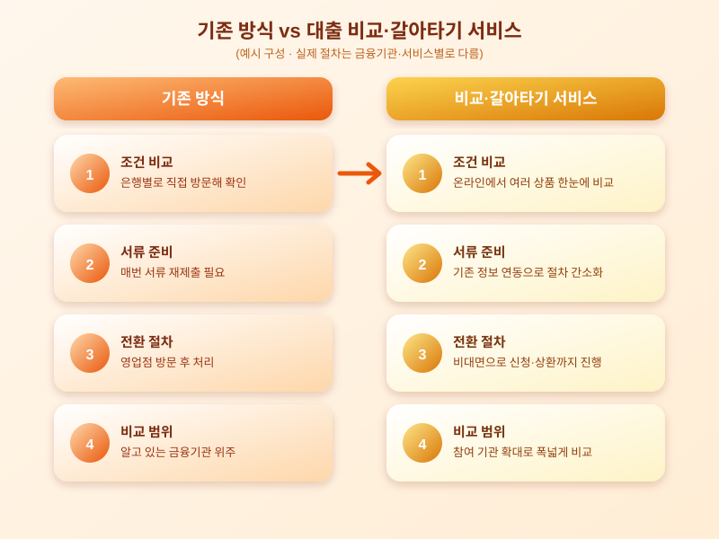

# 대출 비교·갈아타기 서비스 확대, 더 유리한 조건 찾기 쉬워지나

  

대출을 받고 나면 처음 받은 조건 그대로 쭉 이용하는 경우가 많지만, 시간이 지나는 사이 시장에는 더 낮은 금리나 더 유리한 조건의 상품이 꾸준히 나옵니다. 최근에는 온라인에서 여러 금융기관의 대출 조건을 한눈에 비교하고, 손쉽게 다른 상품으로 옮겨 탈 수 있도록 돕는 대출 비교·갈아타기 서비스의 범위가 점점 넓어지는 분위기입니다. 은행 창구를 여러 곳 돌며 서류를 준비하고 조건을 일일이 비교해야 했던 번거로움이 줄면서, 기존 대출을 더 유리한 조건으로 바꾸는 일이 한층 가까워지고 있는 셈입니다.

대출 비교·갈아타기 서비스는 이용자가 자신이 보유한 대출 정보를 입력하면 여러 금융기관이 제시하는 조건을 모아 보여주고, 더 유리한 상품이 있다면 전환 절차까지 온라인에서 이어서 진행할 수 있도록 돕는 방식으로 운영됩니다. 이런 서비스가 확대되는 배경에는 소비자의 선택권을 넓히고 금융기관 사이의 경쟁을 유도해 전반적인 대출 조건을 개선하려는 취지가 자리하고 있습니다. 비교 대상이 되는 대출의 종류와 참여하는 금융기관의 수가 늘어날수록, 이용자가 실제로 체감할 수 있는 선택지도 함께 넓어집니다.

  

이런 서비스가 가져오는 가장 큰 변화는 비교와 전환에 드는 시간과 수고가 크게 줄어든다는 점입니다. 예전에는 금리가 더 낮은 상품을 찾았더라도 서류를 다시 준비하고 심사를 거치는 과정이 번거로워 그냥 기존 대출을 유지하는 경우가 많았습니다. 지금은 비교부터 신청, 기존 대출 상환까지 비대면으로 이어지는 흐름이 자리를 잡아가면서, 조금이라도 유리한 조건이 보이면 실제로 옮겨 타보는 선택이 늘어나고 있습니다.

다만 갈아타기를 고려할 때는 표면적인 금리 차이만 볼 것이 아니라 중도상환수수료, 신규 대출에 따르는 부대비용, 기존에 받고 있던 우대조건의 유지 여부 등을 함께 따져봐야 합니다. 금리가 조금 낮아지더라도 수수료나 조건 변경으로 실제 절감 효과가 크지 않을 수 있기 때문입니다. 자신의 대출 잔액과 남은 상환 기간을 고려해, 갈아탔을 때의 총비용을 꼼꼼히 비교해보는 습관이 필요합니다.

대출 비교·갈아타기 서비스의 문턱이 낮아지는 지금이야말로, 그동안 방치해두었던 자신의 대출 조건을 한 번 점검해볼 좋은 기회입니다. 몇 분의 비교만으로도 생각보다 유리한 조건을 발견할 수 있는 만큼, 가볍게 조회해보는 것부터 시작해보시길 권합니다.

※ 이 초안은 AI가 생성했습니다. 게시 전 수치·정책 내용의 사실관계를 반드시 확인하세요.
