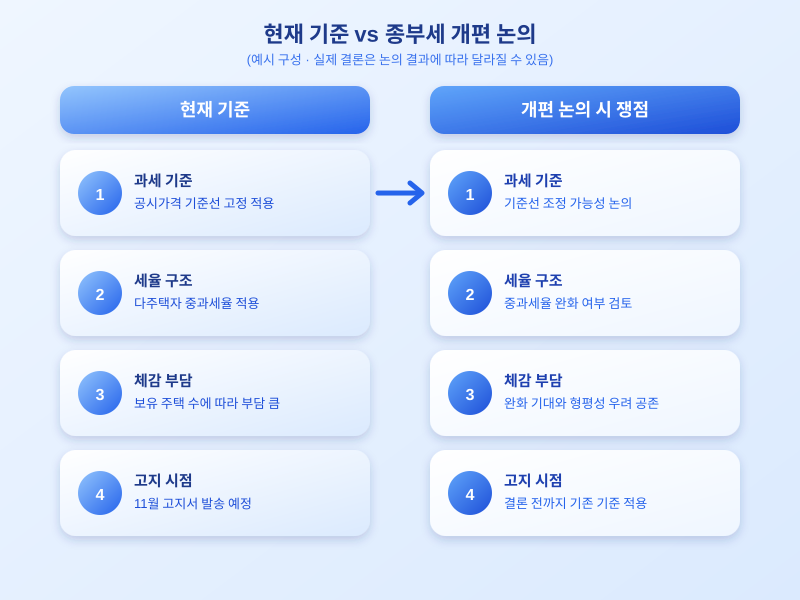

# 다주택자 종합부동산세 개편 논의 재부상, 보유 부담은 어떻게 달라지나

  

매년 11월이 되면 많은 다주택자들이 종합부동산세(종부세) 고지서를 받고 한숨을 내쉽니다. 올해도 다르지 않을 것으로 보이는 가운데, 다주택자 과세 기준을 손보자는 논의가 다시 고개를 들고 있습니다. 보유 부담이 지나치게 크다는 목소리와, 그래도 다주택 보유에 대한 과세는 유지해야 한다는 목소리가 맞서며 개편 방향을 둘러싼 논의가 이어지고 있습니다.

종합부동산세는 일정 금액을 넘는 주택을 보유한 사람에게 매년 부과되는 세금으로, 특히 2주택 이상을 보유한 다주택자에게는 세율이 더 높게 적용되는 구조로 운영되어 왔습니다. 이번에 다시 불거진 개편 논의는 다주택 보유에 따른 세 부담이 지나치게 커서 실수요와 무관한 매물까지 시장에 묶여 있다는 지적, 그리고 거래를 활성화하려면 보유 단계의 부담을 조정할 필요가 있다는 주장에서 출발합니다. 다만 과세 기준을 완화하면 형평성 논란이 다시 불거질 수 있다는 반론도 함께 나오고 있어, 어느 방향으로 결론이 날지는 아직 지켜봐야 하는 상황입니다.

  

만약 개편이 실제로 이뤄진다면 과세 기준이 되는 공시가격 기준선이나 세율 구간, 혹은 1주택자와 다주택자 사이의 세율 차이가 조정될 가능성이 있습니다. 다주택자라면 보유 중인 주택 수와 지역에 따라 세 부담이 달라질 수 있고, 1주택자 역시 간접적으로 영향을 받을 수 있는 만큼 어느 한쪽만의 문제로 보기는 어렵습니다. 특히 올해 공시가격이 오른 지역에 주택을 보유하고 있다면, 개편 논의의 결론과 무관하게 세 부담이 늘어날 가능성도 함께 고려해야 합니다.

종부세 고지서가 발송되기 전인 지금이야말로 자신의 보유 주택 현황과 예상 세액을 미리 점검해볼 좋은 시점입니다. 개편 논의의 결론이 나기 전이라도, 현재 기준으로 예상되는 세 부담을 가늠해두면 고지서를 받은 뒤에도 당황하지 않고 대응할 수 있습니다. 관련 소식이 어떻게 구체화되는지 꾸준히 살펴보며 자신에게 해당하는 변화를 챙겨보시길 권합니다.

※ 이 초안은 AI가 생성했습니다. 게시 전 수치·정책 내용의 사실관계를 반드시 확인하세요.
