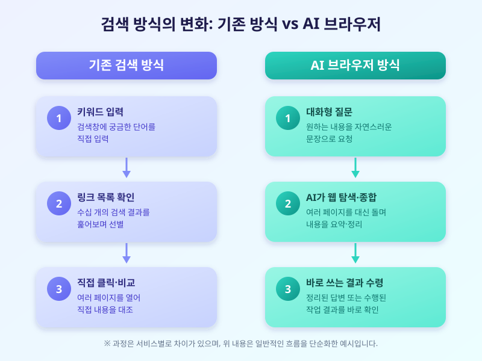

# AI 브라우저 확산, 검색에서 '대화'로 인터넷 이용 방식이 바뀐다

  

얼마 전까지만 해도 인터넷에서 정보를 찾는 방법은 검색창에 궁금한 키워드를 입력하고, 쏟아지는 링크 목록 중에서 하나씩 클릭해 들어가 확인하는 것이었습니다. 하지만 최근에는 이 익숙한 방식 자체가 조금씩 흔들리고 있습니다. 주요 테크 기업들이 대화하듯 질문하면 AI가 웹을 돌아다니며 답을 찾아주는 'AI 브라우저'를 잇따라 내놓으면서, 검색의 개념이 '링크 찾기'에서 '대답 받기'로 옮겨가고 있는 것입니다.

AI 브라우저는 기존 브라우저에 생성형 AI를 결합해, 사용자가 자연어로 질문을 던지면 여러 웹페이지를 종합해 요약된 답을 제시하거나 간단한 작업을 대신 수행해주는 형태로 작동합니다. 예를 들어 여행 일정을 짜달라고 요청하면 여러 사이트를 오가며 숙소와 교통편 정보를 비교해 정리된 결과를 보여주는 식입니다. 이런 변화가 가능해진 배경에는 대규모 언어모델의 성능 향상과, 단순히 검색 결과를 나열받기보다 바로 쓸 수 있는 답을 원하는 사용자들의 요구가 맞물려 있습니다.

  

이런 흐름이 자리를 잡으면 우리가 인터넷을 쓰는 방식도 상당히 달라질 것으로 보입니다. 정보를 찾기 위해 여러 탭을 열어두고 하나씩 비교하던 수고가 줄어드는 대신, AI가 제시한 요약과 결론에 의존하는 비중이 커질 수 있습니다. 편리함은 분명하지만, AI가 요약한 내용이 항상 정확하다고 단정할 수는 없다는 점은 유념할 필요가 있습니다. 또한 AI가 브라우징 과정에서 접근하는 개인 정보나 결제 정보의 범위가 어디까지인지도 이용자 스스로 꼼꼼히 확인해보는 습관이 필요합니다.

AI 브라우저는 아직 초기 단계지만, 확산 속도를 보면 머지않아 일상적인 선택지로 자리잡을 가능성이 높습니다. 새로운 도구를 써보는 것도 좋지만, 중요한 정보일수록 AI의 답변을 그대로 받아들이기보다 한 번 더 원문을 확인하는 습관을 들이는 것이 안전합니다. 편리함과 신뢰성 사이에서 균형을 잡아가는 지혜가 필요한 시점입니다.

※ 이 초안은 AI가 생성했습니다. 게시 전 수치·정책 내용의 사실관계를 반드시 확인하세요.
