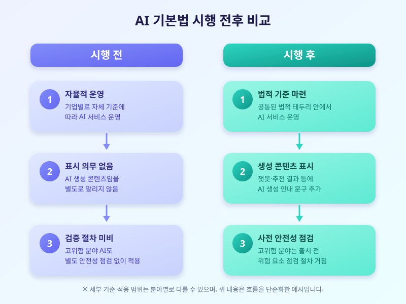

# 국내 AI 기본법 시행, 기업들의 대응은 어떻게 달라지고 있나

  

그동안 인공지능 기술은 뚜렷한 법적 테두리 없이 빠르게 발전해왔지만, 최근 국내에서도 인공지능 관련 기본법이 본격적으로 시행되면서 분위기가 달라지고 있습니다. 고위험 분야에서 쓰이는 AI 시스템의 안전성을 점검하고, 생성형 AI로 만든 콘텐츠에는 AI가 만들었다는 사실을 표시하도록 하는 등의 내용이 법적 테두리 안으로 들어오면서, 기업들은 서비스를 운영하는 방식 자체를 다시 들여다봐야 하는 상황에 놓였습니다.

이번 기본법이 주목받는 배경에는 두 가지 흐름이 겹쳐 있습니다. 하나는 AI 기술이 일상 깊숙이 들어오면서 오작동이나 편향, 가짜 정보 확산 같은 부작용에 대한 우려가 커졌다는 점이고, 다른 하나는 해외 주요국들도 비슷한 규제 체계를 속속 마련하고 있어 국내 기업들도 이에 맞춰 대응 체계를 갖출 필요가 커졌다는 점입니다. 특히 금융, 의료, 채용처럼 사람의 삶에 직접 영향을 주는 분야에서 AI를 활용하는 기업일수록 안전성 검증과 설명 의무에 더 신경을 쓰게 되는 흐름입니다.

  

실제로 여러 기업은 서비스 출시 전에 AI 시스템의 위험 요소를 점검하는 내부 절차를 새로 만들거나 강화하고 있고, 챗봇이나 추천 서비스 화면에 'AI가 생성한 결과'라는 안내 문구를 추가하는 식으로 대응하고 있습니다. 당장은 번거로운 절차로 느껴질 수 있지만, 장기적으로는 이용자 신뢰를 쌓는 과정으로 볼 수도 있습니다. 다만 중소 규모 기업이나 스타트업 입장에서는 검증 절차에 드는 비용과 시간이 부담으로 작용할 수 있어, 제도가 자리 잡는 과정에서 세심한 보완이 필요하다는 목소리도 나옵니다.

이용자 입장에서도 달라지는 점을 챙겨볼 필요가 있습니다. 서비스를 이용하다가 'AI 생성 콘텐츠'라는 표시를 보게 된다면 그 의미를 한 번 더 생각해보고, 중요한 판단을 내릴 때는 AI의 답변을 그대로 믿기보다 다른 경로로도 사실관계를 확인하는 습관을 들이는 것이 좋습니다. AI 기본법은 이제 막 시행 단계에 들어선 만큼 앞으로도 세부 기준과 적용 범위를 둘러싼 논의가 계속될 것으로 보이며, 기업과 이용자 모두 변화하는 제도를 꾸준히 지켜볼 필요가 있습니다.

※ 이 초안은 AI가 생성했습니다. 게시 전 수치·정책 내용의 사실관계를 반드시 확인하세요.
