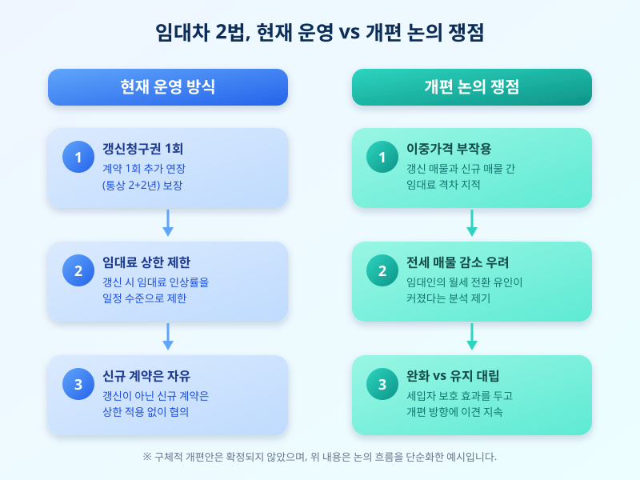

# 임대차 2법 개편 논의 재점화, 전월세 시장 지각변동 오나

  

계약갱신청구권제와 전월세상한제, 이른바 '임대차 2법'이 도입된 지도 꽤 시간이 흘렀습니다. 세입자의 거주 안정을 지키자는 취지로 시작된 제도이지만, 시행 초기부터 지금까지 부작용 논란이 끊이지 않았고, 최근 들어 제도를 손봐야 한다는 목소리가 다시 커지고 있습니다. 전월세 계약을 앞둔 분들이라면 이번 논의의 흐름을 한 번쯤 짚어볼 필요가 있습니다.

개편 논의가 다시 떠오른 배경에는 몇 가지 현실적인 문제의식이 자리하고 있습니다. 갱신 시점의 임대료와 신규 계약 시점의 임대료 사이에 격차가 벌어지는 이른바 '이중가격' 현상이 꾸준히 지적돼 왔고, 임대인들이 전세보다 월세를 선호하게 되면서 전세 매물 자체가 줄어드는 흐름도 함께 거론됩니다. 제도가 오히려 시장을 왜곡시켰다는 비판이 나오는 이유입니다.

  

물론 반론도 만만치 않습니다. 임대차 2법 덕분에 많은 세입자들이 최소 4년에 가까운 거주 기간을 안정적으로 확보할 수 있었고, 급격한 임대료 인상으로부터도 어느 정도 보호받을 수 있었다는 점은 분명한 성과로 꼽힙니다. 그래서 개편 논의도 제도를 아예 되돌리기보다는 부작용을 줄이는 방향으로 손질하자는 쪽에 무게가 실리는 분위기입니다. 다만 구체적으로 갱신 횟수나 상한율을 어떻게 조정할지, 혹은 다른 보완 장치를 도입할지는 아직 뚜렷한 결론이 나오지 않은 상태입니다.

이런 상황에서 임대인과 임차인 모두 당장 할 수 있는 일은 차분히 상황을 지켜보며 현재 시행 중인 규정을 기준으로 계약을 준비하는 것입니다. 갱신 시점이 다가오는 세입자라면 갱신청구권 행사 여부와 임대료 인상 한도를 미리 확인해두는 것이 좋고, 신규 계약을 앞둔 경우라면 특약 사항을 꼼꼼히 살펴 추후 분쟁 소지를 줄이는 편이 안전합니다. 제도 개편은 실제 법 개정으로 이어지기까지 시간이 걸리는 만큼, 성급하게 계약을 서두르기보다는 관련 소식을 꾸준히 확인하면서 합리적인 판단을 내리는 자세가 필요해 보입니다.

※ 이 초안은 AI가 생성했습니다. 게시 전 수치·정책 내용의 사실관계를 반드시 확인하세요.
