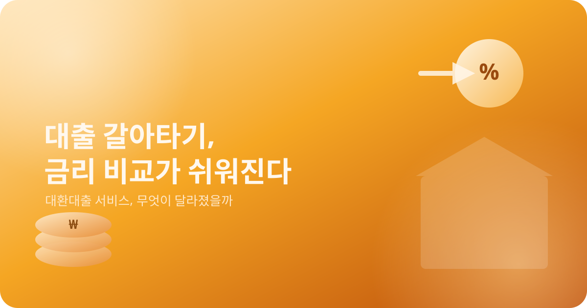
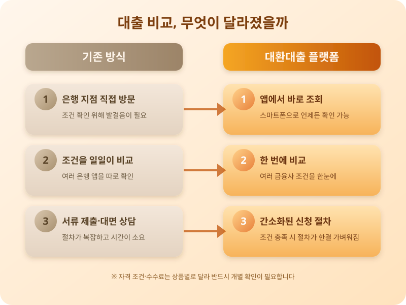

# 대출 갈아타기(대환대출), 금리 비교가 정말 쉬워졌을까

  

최근 몇 년 사이 금융권에서 꾸준히 추진해온 대출 비교·이동 서비스, 흔히 '대환대출' 플랫폼이 적용 범위를 넓혀가고 있다는 소식이 이어지고 있다. 처음에는 신용대출 중심으로 시작했던 서비스가 주택담보대출, 전세대출 등으로 영역을 확대하면서, 더 많은 사람들이 스마트폰 앱 하나로 여러 금융회사의 대출 조건을 한눈에 비교하고 더 유리한 곳으로 옮길 수 있게 됐다는 이야기가 많아지는 중이다.

기존에는 대출을 갈아타려면 여러 은행 지점을 직접 돌아다니거나, 각 은행 앱을 일일이 설치해 조건을 알아봐야 했다. 서류를 떼고 상담을 받는 과정도 번거로웠고, 실제로 얼마나 유리한 조건으로 옮길 수 있는지 비교하기도 쉽지 않았다. 대환대출 인프라가 확대되면서 이런 과정이 플랫폼 안에서 상당 부분 간소화되고 있다는 점은 분명 긍정적인 변화다. 특히 금리에 민감한 실수요자라면, 기존 대출을 그대로 유지하는 것보다 주기적으로 조건을 비교해보는 습관이 유리할 수 있다.

  

다만 실제로 이용할 때는 몇 가지 짚어볼 점이 있다. 비교 플랫폼에 모든 금융회사의 상품이 다 올라와 있는 것은 아니며, 눈에 보이는 금리만이 아니라 중도상환수수료나 각종 부대비용까지 함께 따져봐야 실질적으로 유리한지 판단할 수 있다. 예를 들어 금리가 다소 낮아지더라도 수수료를 포함하면 실익이 크지 않은 경우도 있는데, 이는 상품마다 다르므로 예시로만 참고하면 된다. 또한 소득이나 신용점수, 기존 대출의 종류에 따라 갈아타기 자체가 제한되는 경우도 있어 사전 확인이 필요하다.

대환대출 플랫폼의 확대는 소비자의 선택권을 넓히는 긍정적인 흐름이지만, 편리함만 보고 서둘러 결정하기보다는 자신의 상황에 맞는 조건을 차분히 따져보는 자세가 더 중요하다. 앞으로 서비스 적용 범위가 한층 더 넓어질 것으로 예상되는 만큼, 대출을 계획 중이라면 관련 소식을 꾸준히 살펴보고 비교해보는 것이 좋겠다.

※ 이 초안은 AI가 생성했습니다. 게시 전 수치·정책 내용의 사실관계를 반드시 확인하세요.
