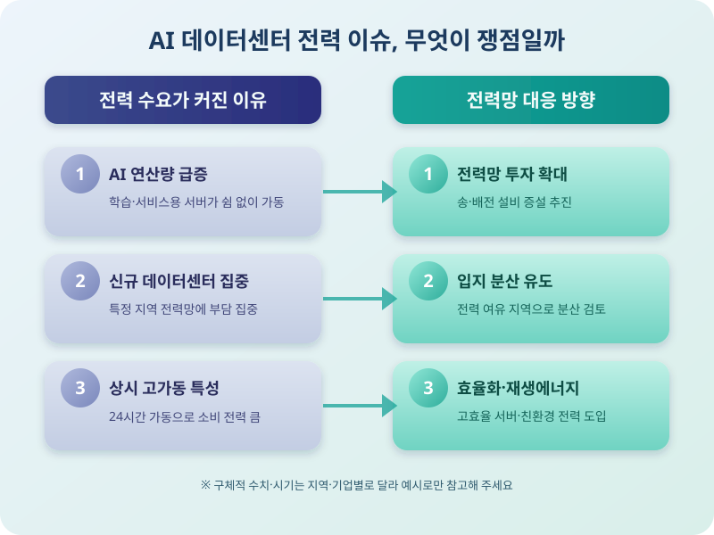

# AI 데이터센터 전력 수요 급증, 전력망은 버틸 수 있을까

  

최근 들어 AI 서비스 이용이 폭발적으로 늘면서, 이를 뒷받침하는 데이터센터의 전력 수요가 빠르게 늘고 있다는 소식이 자주 들린다. 대규모 언어모델을 학습시키고 서비스를 운영하려면 엄청난 연산이 필요한데, 이 연산을 처리하는 서버들이 쉼 없이 돌아가며 많은 전력을 쓰기 때문이다. 단순히 'AI가 똑똑해진다'는 이야기를 넘어, 이제는 전력망과 에너지 공급이라는 현실적인 문제로 논의의 중심이 옮겨가고 있다.

데이터센터 한 곳이 쓰는 전력량은 적지 않은 규모로 커졌고, 이런 시설이 곳곳에 새로 들어서면서 지역 전력망에 부담을 주는 사례도 늘고 있다. 특히 특정 지역에 데이터센터가 몰리면 해당 지역의 전력 공급 설비를 증설해야 하는데, 이는 시간과 비용이 상당히 드는 일이다. 이 때문에 전력망 투자 확대, 데이터센터 입지 분산, 재생에너지 등 새로운 전력 공급원 확보 논의가 동시에 이어지고 있다.

  

국내에서도 데이터센터 유치를 둘러싼 지역별 경쟁이 이어지는 한편, 늘어난 전력 수요를 감당하기 위한 전력망 보강 계획과 전기요금 체계 개편 논의가 함께 진행되고 있다. 데이터센터가 많이 들어서는 지역일수록 전력 공급 안정성과 요금 부담이 함께 쟁점이 될 수 있어, 관련 정책의 방향을 지켜볼 필요가 있다. 또한 기업들도 전력 효율이 높은 서버와 냉각 기술을 도입하며 비용과 환경 부담을 동시에 줄이려는 시도를 이어가고 있다.

AI 기술의 발전 속도를 고려하면 데이터센터의 전력 수요는 앞으로도 꾸준히 늘어날 가능성이 크다. 이는 단순히 전력 산업만의 문제가 아니라, 전기요금이나 지역 개발 방향 등 우리 일상과도 맞닿아 있는 이슈다. 앞으로 전력망 확충과 에너지 공급 다변화가 어떻게 진행되는지, 그리고 그 과정에서 비용 부담이 누구에게 돌아갈지 꾸준히 관심을 가지고 지켜볼 만하다.

※ 이 초안은 AI가 생성했습니다. 게시 전 수치·정책 내용의 사실관계를 반드시 확인하세요.
