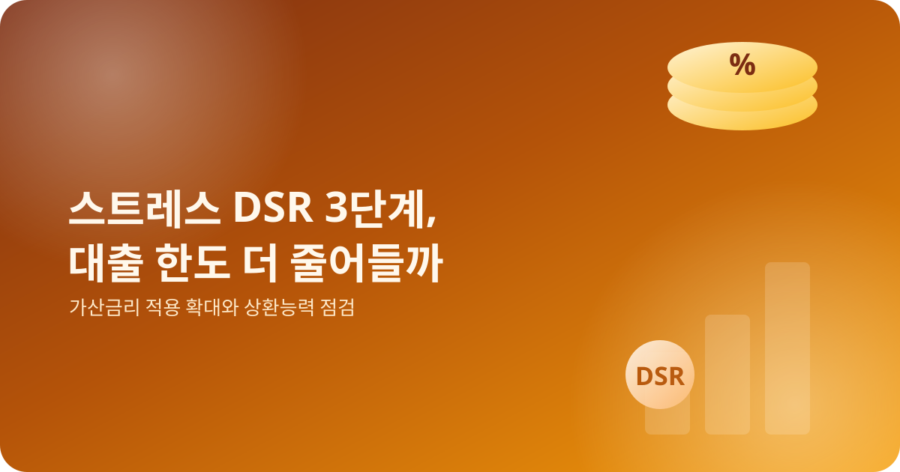
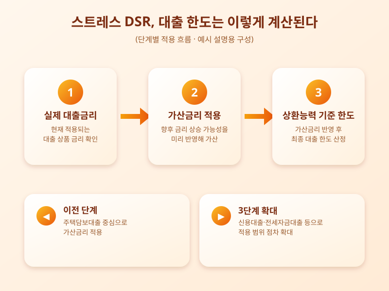

# 스트레스 DSR 3단계 시행, 대출 한도 더 줄어들까

  

최근 대출을 알아보는 사람들 사이에서 '스트레스 DSR'이라는 말이 자주 오르내린다. 앞으로 금리가 오를 가능성까지 미리 반영해 상환능력을 평가하는 이 제도가 단계적으로 강화되면서, 같은 소득이라도 받을 수 있는 대출 한도가 예전보다 줄어드는 경우를 체감하는 사람들이 늘고 있기 때문이다. 내 집 마련이나 생활자금 마련을 위해 대출을 준비하고 있다면, 이번 변화가 구체적으로 무엇을 뜻하는지 미리 짚어볼 필요가 있다.

스트레스 DSR은 실제 적용되는 대출 금리에 일정한 가산금리를 더해 상환능력을 계산하는 방식이다. 당장의 금리만 보고 한도를 산정하면 나중에 금리가 오를 때 상환 부담이 갑자기 커질 수 있다는 우려에서 도입됐다. 이 가산금리를 어느 범위의 대출 상품에, 어느 정도까지 적용하느냐에 따라 단계가 나뉘어 왔고, 적용 범위가 넓어질수록 대출 한도는 더 보수적으로 산정되는 구조다.

  

단계가 진행되면서 가산금리 적용 범위가 주택담보대출 중심에서 신용대출이나 전세자금대출 등으로 점차 확대되는 흐름이 이어지고 있다. 특히 금리 변동 위험이 큰 상품일수록 가산금리가 더 크게 반영될 수 있어, 소득은 그대로인데 받을 수 있는 금액은 줄어드는 상황을 체감하는 사람들이 많아지고 있다.

대출을 준비하는 입장에서는 몇 가지를 미리 점검해두는 것이 좋다. 먼저 희망하는 대출 상품에 가산금리가 어떻게 적용되는지 금융기관을 통해 확인하고, 소득 대비 상환 가능한 금액을 보수적으로 가늠해보는 것이 안전하다. 또한 같은 조건이라도 금융기관이나 상품 구조에 따라 실제 산정되는 한도가 다르게 나올 수 있으므로, 여러 곳을 미리 비교해보는 과정도 필요하다.

한도가 줄어드는 것이 당장은 아쉽게 느껴질 수 있지만, 금리 변동에 대비한 상환능력 관리라는 측면에서는 장기적으로 과도한 빚 부담을 줄여주는 안전장치로도 볼 수 있다. 대출 계획이 있다면 제도 변화의 방향을 꾸준히 확인하면서, 자신의 상환 능력에 맞는 선택을 하는 것이 중요하다.

※ 이 초안은 AI가 생성했습니다. 게시 전 수치·정책 내용의 사실관계를 반드시 확인하세요.
