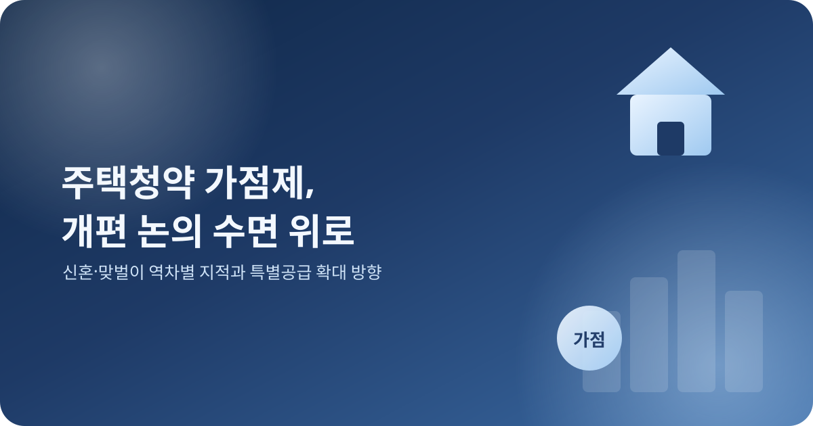
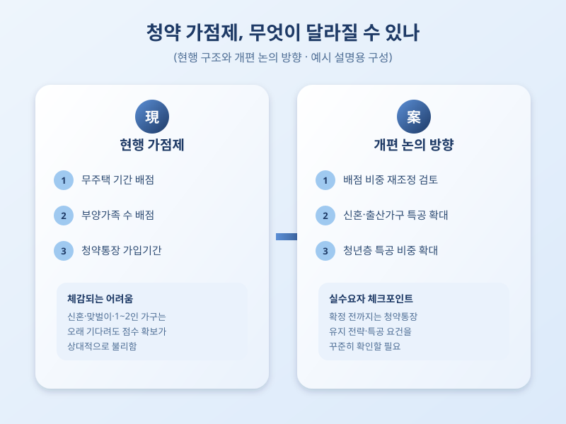

# 청약 가점제, 이대로 괜찮을까…개편 논의 다시 수면 위로

  

청약을 준비하는 사람들 사이에서 '가점제'를 둘러싼 불만이 다시 커지고 있다. 무주택 기간, 부양가족 수, 청약통장 가입 기간을 합산해 당첨자를 가리는 현재의 가점제가 특정 조건을 갖춘 사람에게만 유리하게 작용한다는 지적이 이어지면서, 제도 개편 논의가 다시 수면 위로 떠올랐다. 내 집 마련을 준비 중이라면 이번 논의가 어떤 방향으로 흘러갈지 미리 짚어볼 필요가 있다.

현재 청약 가점제는 무주택 기간이 길수록, 부양가족이 많을수록, 청약통장 가입 기간이 오래될수록 높은 점수를 받는 구조다. 오래 기다리고 많은 식구를 책임진 사람에게 기회를 주자는 취지로 만들어졌지만, 그 사이 결혼 연령이 늦어지고 맞벌이 가구가 늘면서 상황이 달라졌다. 자녀 계획이 늦거나 부모와 따로 사는 1~2인 가구, 신혼부부는 아무리 오래 청약통장을 유지해도 점수에서 밀리는 경우가 많아, 제도가 현실을 따라가지 못한다는 목소리가 커지고 있다.

  

이런 지적에 따라 가점 항목의 비중을 조정하거나, 특별공급 물량을 늘려 가점제의 사각지대를 보완하자는 방향의 논의가 오가고 있다. 무주택 기간이나 부양가족 수에 지나치게 쏠린 배점 구조를 손보고, 신혼·출산가구나 청년 등 실수요층을 겨냥한 특별공급 비중을 확대하는 방안이 대표적으로 거론된다. 다만 어떤 기준을 손보든 누군가는 유리해지고 누군가는 불리해지는 성격의 논의인 만큼, 세부안이 확정되기까지는 시간이 걸릴 가능성이 크다.

청약을 준비하고 있다면 당장 바뀌는 것이 없다고 안심하기보다는, 논의되는 개편 방향을 꾸준히 살펴보는 것이 좋다. 특히 특별공급 요건이나 가점 산정 기준이 조정될 경우 본인에게 유리해지는지 불리해지는지 미리 가늠해보고, 청약통장 유지 전략이나 청약 지역 선택도 함께 재점검해볼 필요가 있다. 제도가 바뀌는 흐름 속에서 본인의 상황에 맞는 전략을 세우는 것이 실수요자에게 가장 중요한 대응이다.

※ 이 초안은 AI가 생성했습니다. 게시 전 수치·정책 내용의 사실관계를 반드시 확인하세요.
