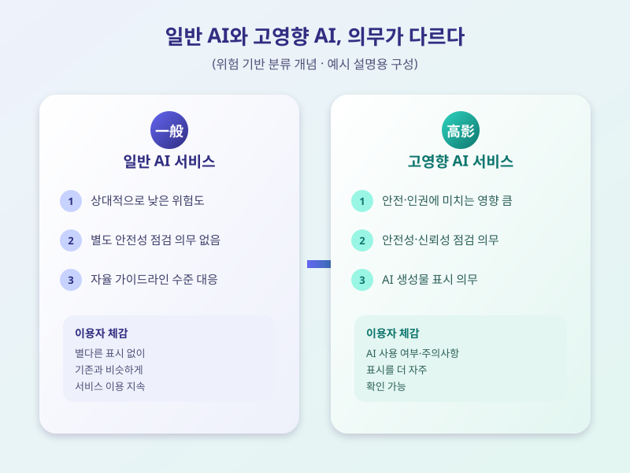

# AI 기본법 시행 앞두고, 기업들의 준비 어디까지 왔나

  

인공지능 서비스를 규율하는 'AI 기본법' 시행 시점이 다가오면서 기업들의 움직임이 분주해지고 있다. 그동안 가이드라인 수준에 머물렀던 AI 관련 규율이 법적 의무로 바뀌는 만큼, 서비스를 개발하고 운영하는 기업뿐 아니라 이를 이용하는 일반 이용자에게도 적지 않은 변화가 예상된다. 법 시행을 앞두고 어떤 내용이 달라지는지 지금 시점에서 짚어볼 필요가 있다.

AI 기본법의 핵심은 AI 시스템을 위험도에 따라 구분하고, 사람의 안전이나 권익에 큰 영향을 줄 수 있는 '고영향 AI'에 대해서는 더 엄격한 의무를 부과하는 데 있다. 이런 고영향 AI를 개발하거나 활용하는 기업은 안전성과 신뢰성을 점검하는 절차를 마련해야 하고, 이용자에게는 AI가 만든 결과물임을 명확히 알리는 투명성 의무도 함께 따른다. 챗봇 상담, 채용 심사, 금융 상품 추천 등 실생활과 밀접한 영역일수록 해당 의무가 적용될 가능성이 커 기업들의 고민이 깊다.

  

법 시행을 앞두고 업계에서는 기대와 우려가 함께 나온다. 안전장치를 갖춘 서비스가 늘어나면 이용자 신뢰가 높아질 것이라는 기대가 있지만, '고영향 AI'의 범위가 명확하지 않아 어디까지 준비해야 하는지 혼란스럽다는 목소리도 적지 않다. 특히 자원이 상대적으로 부족한 중소기업·스타트업 입장에서는 규제 준수 부담이 사업 속도를 늦출 수 있다는 걱정도 함께 제기된다.

일반 이용자 입장에서는 앞으로 AI가 만든 답변이나 이미지, 추천 결과에 관련 표시가 더 자주 눈에 띄게 될 가능성이 크다. 당장 모든 서비스가 한꺼번에 바뀌지는 않겠지만, 이용 중인 서비스가 어떤 AI를 어떻게 활용하는지 한 번씩 관심을 가져보는 것도 좋은 습관이 될 수 있다. 법 시행 초기에는 세부 기준을 둘러싼 조정이 이어질 가능성이 큰 만큼, 기업과 이용자 모두 관련 소식을 꾸준히 확인해두는 것이 바람직하다.

※ 이 초안은 AI가 생성했습니다. 게시 전 수치·정책 내용의 사실관계를 반드시 확인하세요.
