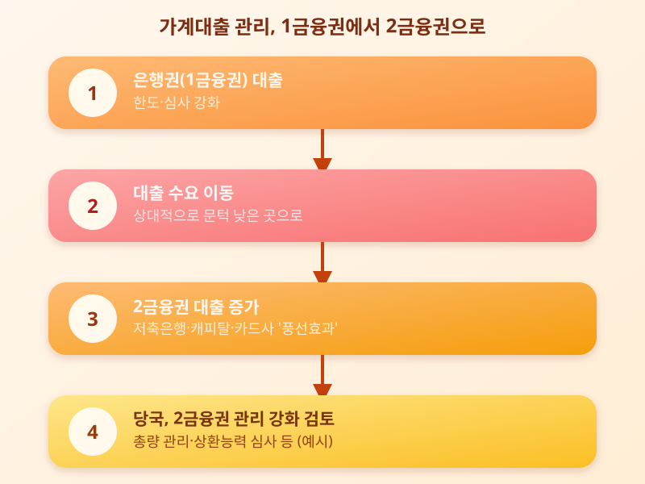

# 2금융권 대출 조이기 본격화, 서민 대출 문턱 더 높아지나

  

최근 은행권의 가계대출 관리가 한층 엄격해지면서, 대출 수요가 저축은행이나 캐피탈사 같은 2금융권으로 옮겨가는 '풍선효과' 우려가 커지고 있다. 이에 따라 금융당국도 2금융권 가계대출 관리를 강화하는 방안을 함께 들여다보고 있는 모습이다. 그동안 상대적으로 문턱이 낮다고 여겨졌던 2금융권 대출까지 조여진다면, 신용도가 낮거나 소득 증빙이 쉽지 않은 서민·자영업자들이 느끼는 부담은 한층 커질 수 있다.

2금융권 대출이 늘어나는 배경에는 1금융권인 은행의 대출 한도와 심사가 강화되면서, 상대적으로 문턱이 낮은 2금융권으로 수요가 옮겨가는 구조가 깔려 있다. 하지만 2금융권 대출은 금리가 은행보다 높은 경우가 많아, 당장은 대출을 받기 쉬워도 장기적인 상환 부담이 더 커질 수 있다는 우려가 꾸준히 제기된다.

  

금융당국은 이런 흐름을 억제하기 위해 2금융권에도 가계대출 총량 관리나 상환능력 심사를 강화하는 방향의 조치를 검토하는 것으로 알려졌다. 다만 지나치게 급격한 조치는 자금이 꼭 필요한 서민·자영업자의 숨통을 틔워주는 통로마저 막을 수 있다는 점에서, 속도와 범위를 둘러싼 고민도 함께 커지고 있다.

업계에서는 이번 조치가 실제로 어떤 방식과 속도로 시행되는지에 따라 체감되는 영향이 크게 달라질 것으로 보고 있다. 특히 2금융권 대출을 이미 이용 중이거나 이용을 앞둔 사람이라면, 한도나 금리 조건이 예고 없이 바뀔 수 있다는 점을 염두에 두고 대출 계획을 세우는 것이 바람직하다. 필요하다면 여러 금융기관의 조건을 미리 비교해보고, 상환 계획을 보수적으로 잡아두는 것도 도움이 될 수 있다.

가계대출 관리 강화 흐름은 이제 1금융권에서 2금융권으로 무게중심이 옮겨가는 단계에 들어선 것으로 보인다. 앞으로 나올 구체적인 방안과 시행 시점에 따라 서민·자영업자가 느끼는 체감도는 달라질 수 있는 만큼, 관련 소식을 꾸준히 확인하며 자신의 상황에 맞는 대응 방안을 미리 준비해두는 자세가 필요하다.

※ 이 초안은 AI가 생성했습니다. 게시 전 수치·정책 내용의 사실관계를 반드시 확인하세요.
