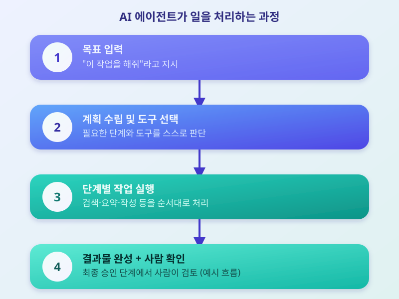

# AI 에이전트 확산, 일하는 방식이 바뀐다

  

최근 몇 년 동안 생성형 AI가 질문에 답하는 '챗봇' 역할에 머물렀다면, 요즘은 스스로 계획을 세우고 여러 단계를 거쳐 작업을 수행하는 'AI 에이전트'가 빠르게 확산되고 있다. 단순히 텍스트를 생성하는 수준을 넘어, 이메일 정리, 일정 조율, 문서 작성, 간단한 코드 수정 같은 실제 업무를 사람 대신 처리하는 서비스들이 속속 등장하면서, 일하는 방식 자체가 달라지고 있다는 평가가 나온다.

AI 에이전트가 주목받는 이유는 '대화'에서 '실행'으로 역할이 넘어갔기 때문이다. 기존 챗봇은 사용자가 질문을 던지면 답변을 주는 데 그쳤지만, 에이전트형 AI는 목표만 입력하면 필요한 도구를 스스로 선택하고 여러 단계를 거쳐 결과물을 완성한다. 예를 들어 "이번 주 회의 내용을 정리해 요약 메일을 보내줘"라고 요청하면, 회의록을 찾아 읽고 핵심을 요약한 뒤 메일 초안까지 작성하는 식이다. 이런 흐름이 늘면서 기업들도 반복 업무를 AI에 맡기고, 사람은 판단과 검토에 집중하는 쪽으로 업무 분담을 재편하는 모습이다.

  

다만 이런 변화가 마냥 장밋빛인 것만은 아니다. AI 에이전트가 잘못된 정보를 바탕으로 엉뚱한 작업을 처리하거나, 권한 범위를 넘어서는 행동을 할 위험도 함께 거론된다. 이 때문에 업계에서는 에이전트가 중요한 결정을 내리기 전에 사람의 최종 확인을 거치도록 하는 안전장치, 이른바 '휴먼 인 더 루프' 설계가 중요하다는 목소리가 커지고 있다. 또한 에이전트에게 어디까지 접근 권한을 줄 것인지, 오작동이 발생했을 때 책임은 누가 질 것인지 등 아직 정리되지 않은 문제도 많다.

결국 AI 에이전트의 확산은 기술적 진보인 동시에, 사람과 AI의 역할 분담을 새로 짜야 하는 과제이기도 하다. 당장 모든 업무를 맡기기보다는 반복적이고 검증 가능한 작업부터 단계적으로 맡겨보면서 신뢰를 쌓아가는 접근이 필요해 보인다. 이 흐름이 앞으로 어떤 방향으로 자리잡을지, 관련 서비스와 제도 변화를 꾸준히 지켜볼 필요가 있다.

※ 이 초안은 AI가 생성했습니다. 게시 전 수치·정책 내용의 사실관계를 반드시 확인하세요.
