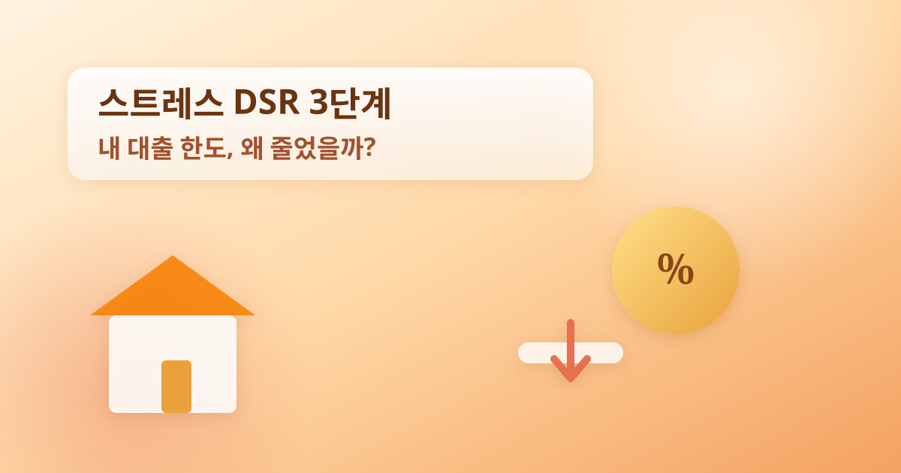
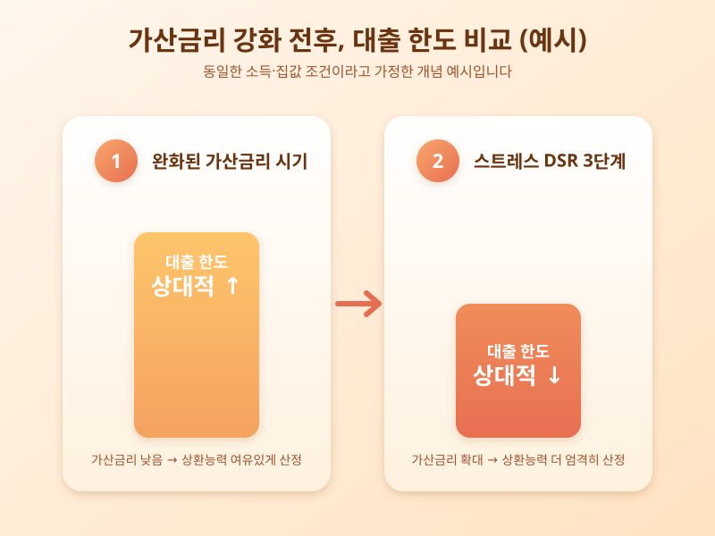

# 스트레스 DSR 3단계, 내 대출 한도는 얼마나 줄었을까

  

최근 은행 창구에서 대출 상담을 받아본 사람이라면 "스트레스 DSR 적용으로 한도가 줄었다"는 설명을 한 번쯤 들어봤을 것이다. 단계적으로 강화되어 온 스트레스 DSR 제도가 3단계에 접어들면서, 소득과 집값 조건이 비슷해도 예전보다 빌릴 수 있는 돈이 눈에 띄게 줄어드는 경험을 하는 사람들이 늘고 있다. 왜 지금 이런 변화가 더 크게 체감되는지 짚어본다.

스트레스 DSR은 대출 한도를 산정할 때 현재 적용 금리가 아니라, 앞으로 금리가 오를 가능성을 미리 반영한 '가산금리'를 더해 상환 능력을 계산하는 제도다. 지금 금리가 낮더라도 미래에 오를 수 있다는 가정을 깔고 더 엄격한 기준으로 한도를 산정하는 셈이다. 이 가산금리가 단계적으로 커지면서, 도입 초기보다 지금의 한도 축소 폭이 훨씬 크게 느껴지는 것이다. 특히 주택담보대출뿐 아니라 신용대출, 2금융권 대출까지 적용 범위가 점차 넓어지면서, 여러 금융기관에서 대출을 나눠 받던 방식의 효과도 예전만 못해졌다.

  

문제는 이런 변화가 모든 대출자에게 똑같이 다가오지 않는다는 점이다. 소득이 일정하고 고정금리를 주로 이용하는 사람보다, 소득 증빙이 복잡하거나 변동금리·신용대출 비중이 높은 사람일수록 한도 축소를 더 크게 체감하게 된다. 그만큼 내 집 마련이나 전월세 자금 계획을 세울 때는 과거 기준의 '예상 한도'를 그대로 믿지 말고, 최신 기준으로 다시 계산해보는 과정이 꼭 필요해졌다.

결국 스트레스 DSR 강화는 단순한 규제 변화가 아니라, 대출을 이용하는 방식 자체를 다시 점검해야 한다는 신호로 읽을 필요가 있다. 대출 계획이 있다면 금융기관 창구나 공식 채널을 통해 본인의 최신 한도를 꼼꼼히 확인하고, 금리 변동 가능성까지 감안한 여유 있는 자금 계획을 세우는 것이 중요하다.

※ 이 초안은 AI가 생성했습니다. 게시 전 수치·정책 내용의 사실관계를 반드시 확인하세요.
