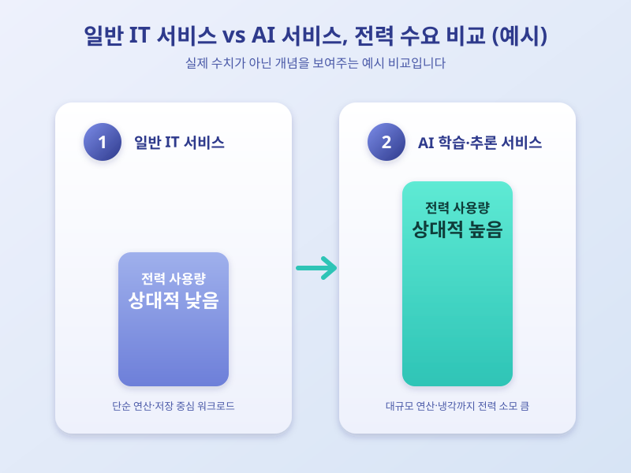

# AI가 커질수록 전기도 많이 먹는다, 데이터센터 전력난이 던지는 질문

  

최근 AI 서비스가 빠르게 늘면서, 그 뒤에서 쉬지 않고 돌아가는 데이터센터의 전력 소비가 새로운 화두로 떠오르고 있다. 대화형 AI 하나를 돌리는 데도 상당한 연산이 필요하고, 서버와 냉각 설비는 끊임없이 전기를 쓴다. 왜 지금 이 문제가 더 크게 부각되는지 짚어본다.

AI 모델이 똑똑해질수록 학습과 추론에 필요한 연산량도 늘어난다. 서버 운영뿐 아니라 열을 식히는 냉각 과정에도 전력이 많이 들어, 이용자가 체감하지 못하는 사이 데이터센터의 전력 수요는 가파르게 커지고 있다. 대규모 AI 인프라가 들어서는 지역에서는 기존 전력망으로 늘어난 수요를 감당하기 어려운 상황도 나타난다.

  

이 때문에 기업과 정부 모두 전력 공급 방안을 고민하는 중이다. 일부 기업은 전용 발전 설비 투자를 검토하거나 전력 효율을 높이는 기술에 힘을 쏟고, 각국 정부는 전력망 확충과 재생에너지 비중 확대 같은 대책을 논의한다. 다만 인프라 확충에는 시간과 비용이 들어, 긴장이 쉽게 풀리지 않을 수 있다는 전망도 나온다.

결국 AI 산업의 성장은 더 좋은 모델을 만드는 문제를 넘어, 전력을 어떻게 안정적으로 확보하느냐의 문제와 맞물려 있다. 앞으로 AI 서비스 논의에서는 성능이나 활용뿐 아니라, 이를 지탱하는 에너지 인프라의 지속가능성도 눈여겨볼 필요가 있다.

※ 이 초안은 AI가 생성했습니다. 게시 전 수치·정책 내용의 사실관계를 반드시 확인하세요.
