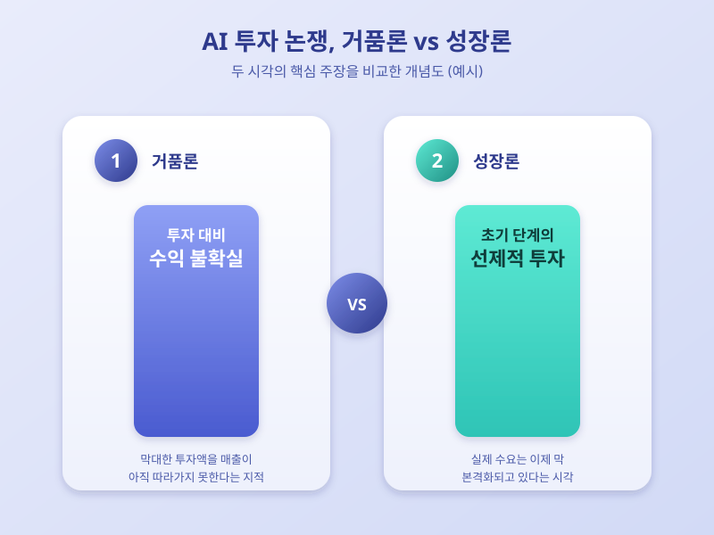

# AI 투자는 거품인가, 성장인가 — 버블 논쟁이 던지는 질문

  

최근 들어 AI 산업에 대한 투자 열기가 계속되는 가운데, 이를 두고 거품이 아니냐는 우려와 아직 성장 초기 단계라는 반박이 동시에 나오고 있다. 대형 기술기업들이 데이터센터와 반도체에 막대한 자금을 쏟아붓는 모습이 이어지면서, 이 흐름이 지속 가능한지에 대한 궁금증이 커지는 시점이다. 증시에서도 AI 관련 기업들의 주가가 큰 폭으로 움직일 때마다 거품 논쟁이 다시 수면 위로 떠오르곤 한다.

거품론을 펴는 쪽은 투자 규모와 실제 수익 사이의 간극을 지적한다. AI 서비스로 벌어들이는 매출이 아직 투자액을 따라가지 못하는 상황에서, 기대만으로 자금이 몰리는 모습이 과거 버블 사례와 닮아 있다는 것이다. 또한 비슷한 인프라에 여러 기업이 동시에 뛰어들면서 중복 투자나 과잉 설비에 대한 우려도 함께 제기된다.

  

반면 성장론을 지지하는 쪽은 AI 기술이 아직 초기 단계에 머물러 있고, 실제 산업 현장에서의 활용은 오히려 이제 막 본격화되고 있다고 본다. 지금의 투자는 거품이 아니라 다가올 수요를 미리 준비하는 선제적 투자라는 시각이다. 투자 회수에는 시간이 걸리더라도 방향성 자체는 유효하다는 주장이며, 과거 신기술 도입 초기에도 비슷한 논쟁이 반복됐다는 점을 근거로 든다.

이 논쟁을 지켜보는 투자자와 기업이라면, 단기적인 주가나 투자 뉴스보다 실제 수익모델이 얼마나 구체화되고 있는지, 투자가 특정 소수 기업에 과도하게 집중되고 있지는 않은지를 함께 살펴볼 필요가 있다. 거품이든 성장이든, 결국 중요한 것은 투자에 걸맞은 실질적인 가치가 뒤따르는지를 꼼꼼히 확인하는 자세일 것이다.

※ 이 초안은 AI가 생성했습니다. 게시 전 수치·정책 내용의 사실관계를 반드시 확인하세요.
