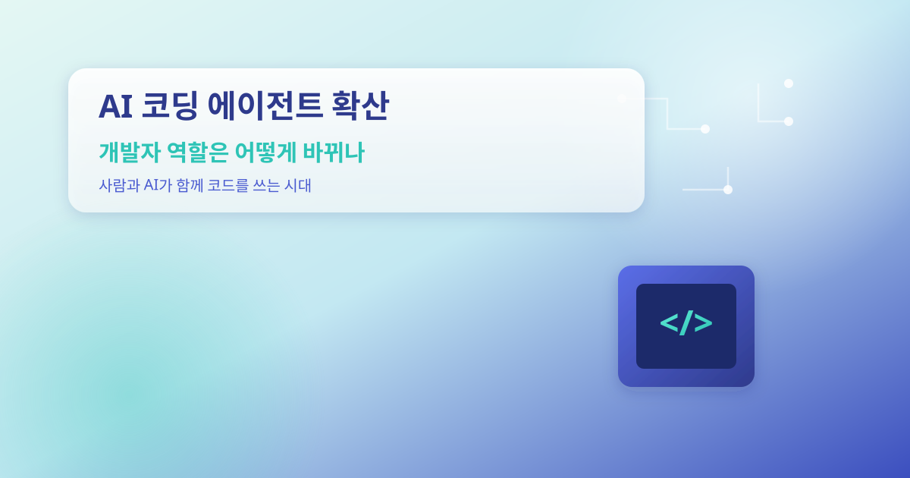
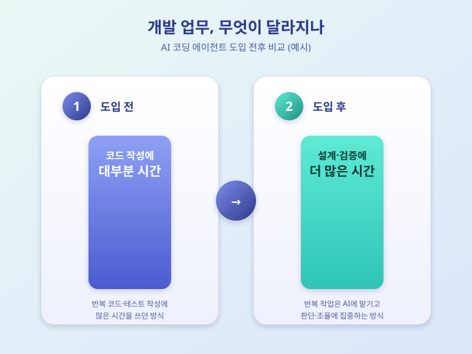

# AI 코딩 에이전트 확산, 개발자 역할은 어떻게 바뀌나

  

최근 소프트웨어 개발 현장에서 가장 자주 언급되는 화두는 코드를 직접 작성하고 수정해주는 AI 에이전트 도구다. 과거의 AI 코드 자동완성이 단순히 문장을 이어 써주는 수준이었다면, 지금의 코딩 에이전트는 요구사항을 이해하고 여러 파일을 오가며 기능을 구현하거나 버그를 고치는 작업까지 스스로 처리한다. 개발자들 사이에서는 이러한 도구가 일상적인 작업 도구로 빠르게 자리잡고 있다는 체감이 커지는 분위기다.

가장 눈에 띄는 변화는 반복적이고 정형화된 코드 작성 작업이 크게 줄어든다는 점이다. 테스트 코드 작성, 비슷한 패턴의 기능 구현, 문서화처럼 시간이 많이 들지만 창의성이 크게 필요하지 않은 작업을 AI 에이전트에 맡기는 사례가 늘고 있다. 그 결과 개발자는 더 많은 시간을 설계와 의사결정에 쓸 수 있게 됐다는 긍정적 평가가 나온다.

  

하지만 그렇다고 개발자의 역할이 사라지는 것은 아니라는 시각이 지배적이다. AI 에이전트가 작성한 코드라도 이것이 실제로 올바르게 동작하는지, 보안상 문제가 없는지, 전체 시스템 구조와 잘 맞는지를 판단하고 검증하는 일은 여전히 사람의 몫이다. 특히 복잡한 요구사항을 정리하고 우선순위를 정하는 기획·설계 단계, 그리고 여러 대안 중 하나를 선택하는 의사결정은 AI가 대신하기 어려운 영역으로 꼽힌다.

결국 AI 코딩 에이전트의 확산이 던지는 질문은 개발자가 사라지느냐가 아니라, 개발자에게 요구되는 역량이 어떻게 달라지느냐에 있다. 코드를 한 줄씩 직접 짜는 능력보다 AI가 만든 결과물을 빠르게 검증하고, 전체 시스템을 조율하는 능력이 더 중요해지는 방향으로 흘러갈 가능성이 크다. 이러한 흐름을 어떻게 받아들이고 준비하느냐가 앞으로 개발자 개개인의 경쟁력을 가르는 기준이 될 것으로 보인다.

※ 이 초안은 AI가 생성했습니다. 게시 전 수치·정책 내용의 사실관계를 반드시 확인하세요.
