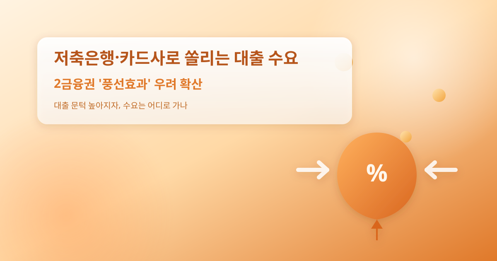
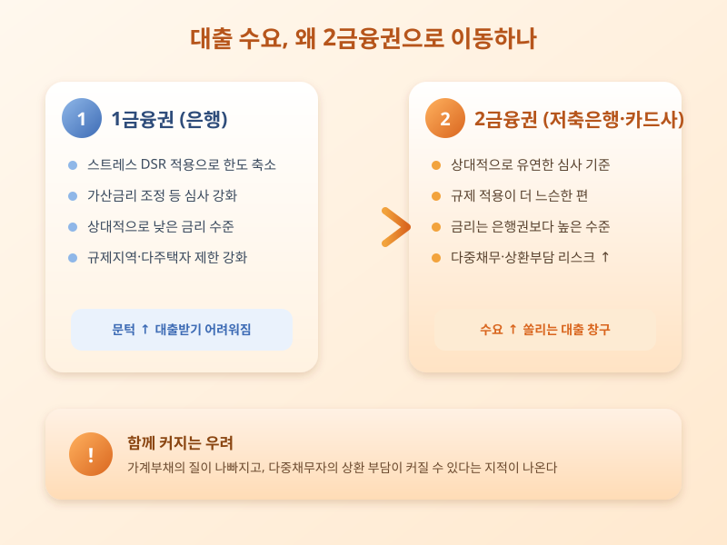

# 저축은행·카드사로 쏠리는 대출 수요, 2금융권 '풍선효과' 우려 확산

  

은행에서 대출받기가 점점 까다로워지면서, 그 수요가 저축은행이나 카드사 같은 2금융권으로 옮겨가는 모습이 뚜렷해지고 있다. 흔히 '풍선효과'라고 부르는 현상으로, 한쪽을 누르면 다른 쪽이 부풀어 오르듯 특정 경로의 대출을 규제하면 수요가 상대적으로 규제가 덜한 곳으로 이동한다는 뜻이다. 스트레스 DSR 적용과 가산금리 조정으로 은행권 대출 한도가 줄어든 차주들이 2금융권 문을 두드리는 사례가 늘고 있다는 체감이 커지는 분위기다.

저축은행이나 카드사, 캐피탈사는 상대적으로 심사 기준이 유연하고 규제 적용도 은행권보다 느슨한 편이어서, 은행에서 한도를 채우지 못한 수요자들이 발길을 돌리기 쉬운 구조다. 특히 다주택자나 신용점수가 낮은 차주일수록 1금융권 문턱을 넘기 어려워지면서 2금융권으로 이동하는 경향이 두드러진다는 분석이 나온다.

  

문제는 2금융권 대출의 금리가 은행권보다 높은 경우가 많다는 점이다. 대출 한도를 늘리는 대신 상환 부담이 커지는 구조여서, 이미 여러 대출을 안고 있는 다중채무자의 상환 위험이 함께 커질 수 있다는 지적이 나온다. 가계부채 총량은 줄어드는 것처럼 보여도 부채의 질이 나빠지면 금융시스템 전반의 리스크로 이어질 수 있다는 우려도 꾸준히 제기된다. 이런 흐름이 길어지면 금융당국이 2금융권에 대한 모니터링이나 추가 규제를 검토할 가능성도 배제할 수 없다.

따라서 2금융권 대출을 고려하는 사람이라면 단순히 한도만 보고 결정하기보다, 금리 수준과 상환 계획을 꼼꼼히 따져보는 것이 중요하다. 여러 금융사의 조건을 비교하고, 기존 대출과 합쳐 상환 능력 안에서 감당할 수 있는지를 먼저 점검해야 한다. 앞으로 금융당국의 추가 대응 여부도 함께 지켜볼 필요가 있다.

※ 이 초안은 AI가 생성했습니다. 게시 전 수치·정책 내용의 사실관계를 반드시 확인하세요.
