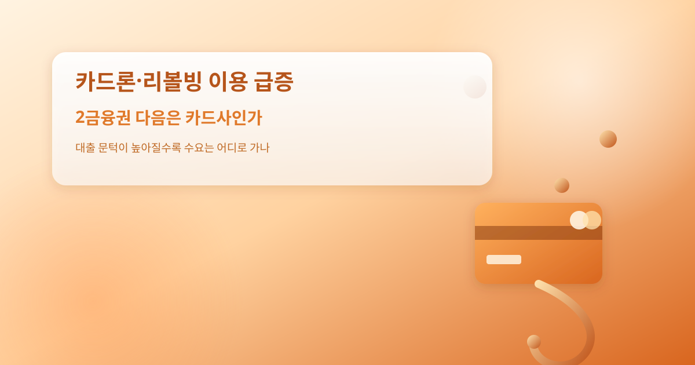
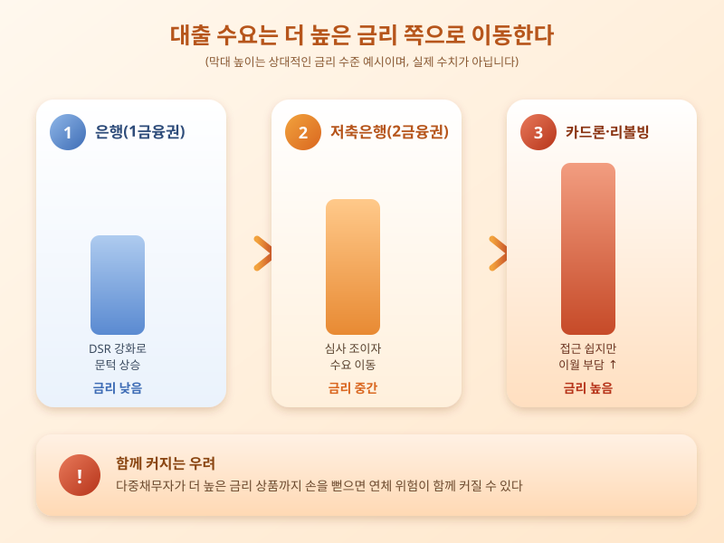

# 카드론·리볼빙 이용 급증, 2금융권 다음은 카드사인가

  

은행과 저축은행에서 대출받기가 어려워지면서, 이번엔 카드론과 리볼빙 같은 카드사의 단기 대출상품으로 수요가 옮겨가는 모습이 나타나고 있다. 스트레스 DSR과 가산금리 조정으로 1금융권 문턱이 높아지고 2금융권인 저축은행까지 심사를 조이자, 그보다 접근이 쉬운 카드론이나 결제금액 일부만 갚고 나머지를 이월하는 리볼빙으로 돈을 빌리는 사람이 늘고 있다는 지적이다.

카드론과 리볼빙은 별도의 서류 심사나 담보 없이 신용카드만 있으면 간단하게 이용할 수 있어 급전이 필요한 사람에게 매력적인 선택지로 보인다. 그러나 두 상품 모두 금리 수준이 저축은행보다도 높은 편이고, 특히 리볼빙은 매달 최소 금액만 납부하면 되는 구조여서 갚아야 할 원금과 이자가 눈덩이처럼 불어나기 쉽다는 함정이 있다.

  

문제는 이런 흐름이 개별 소비자의 상환 부담을 넘어 가계부채 전반의 질을 떨어뜨릴 수 있다는 점이다. 은행 대출을 줄여 가계부채 총량을 관리하려는 정책이, 결국 금리가 더 높은 대출로 수요를 밀어내는 '풍선효과의 연쇄'로 이어질 수 있다는 우려가 나온다. 다중채무자가 카드론·리볼빙까지 손을 뻗으면 연체로 이어질 위험도 함께 커진다. 이런 흐름이 계속되면 금융당국이 카드사의 리볼빙 운영 실태나 광고 방식에 대한 점검을 강화할 가능성도 배제할 수 없다.

따라서 카드론이나 리볼빙을 급전 수단으로 고려한다면, 당장의 편리함보다 실제 부담하게 될 금리와 상환 구조를 먼저 확인하는 것이 중요하다. 최소 결제만 이어가다 보면 빚이 커질 수 있다는 점을 염두에 두고, 짧은 기간 안에 전액 상환할 수 있는지를 따져봐야 한다. 이미 여러 대출을 안고 있다면 추가 이용보다 기존 빚을 정리하는 방법부터 점검하는 것이 바람직하다.

※ 이 초안은 AI가 생성했습니다. 게시 전 수치·정책 내용의 사실관계를 반드시 확인하세요.
