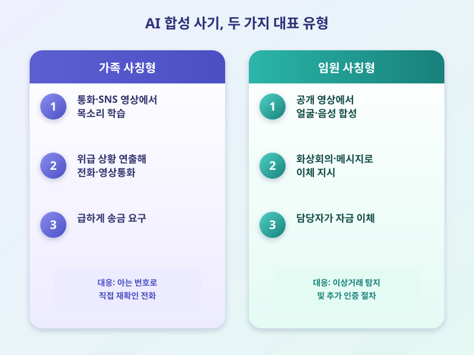

# AI 보이스피싱·딥페이크 사기 확산, 금융권 보안 대응은

  

AI 음성·영상 합성 기술이 빠르게 발전하면서, 가족이나 지인의 목소리를 흉내 낸 보이스피싱이나 실제 인물처럼 보이는 딥페이크 영상을 이용한 금융 사기가 늘고 있다는 우려가 커지고 있다. 과거엔 어색한 말투나 부자연스러운 영상으로 사기임을 눈치챌 수 있었지만, 이제는 AI가 만들어낸 음성과 영상이 실제와 구분하기 어려울 정도로 정교해지면서 피해 유형도 다양해지는 추세다.

특히 가족의 목소리를 짧은 통화나 SNS 영상에서 학습해 위급한 상황을 가장해 급하게 돈을 요구하는 방식이 가장 주의해야 할 유형으로 꼽힌다. 기업 임원의 얼굴과 음성을 합성해 자금 이체를 지시하는 것처럼 꾸미는 사례도 해외에서 보고되며, 국내 금융권도 비슷한 수법이 국내에 유입될 가능성을 경계하고 있다. 전화번호나 화면에 보이는 얼굴만으로는 더 이상 상대를 완전히 믿기 어려운 시대가 된 셈이다.

  

이에 금융당국과 은행권은 평소와 다른 패턴의 거래가 발생하면 추가 인증 절차를 거치도록 하는 등 이상거래 탐지 체계를 강화하는 방향으로 대응을 모색하고 있다. 다만 기술 발전 속도를 감안하면 제도적 대응만으로는 한계가 있을 수밖에 없고, 결국 개인이 의심스러운 요청에 대해 스스로 확인 절차를 거치는 습관을 들이는 것이 중요하다는 지적이 나온다.

가족이나 지인을 사칭한 급한 연락을 받았다면, 먼저 알고 있는 번호로 직접 전화해 사실을 확인하거나 미리 정해둔 질문으로 본인 여부를 확인하는 것이 안전하다. 큰돈을 요구하거나 서두르는 말투로 압박한다면 일단 통화를 끊고 시간을 두는 것도 좋은 방법이다. AI가 사기의 도구로 악용될 수 있다는 점을 전제로, 금전이 오가는 상황에서는 한 번 더 의심하고 검증하는 자세가 필요한 시점이다.

※ 이 초안은 AI가 생성했습니다. 게시 전 수치·정책 내용의 사실관계를 반드시 확인하세요.
