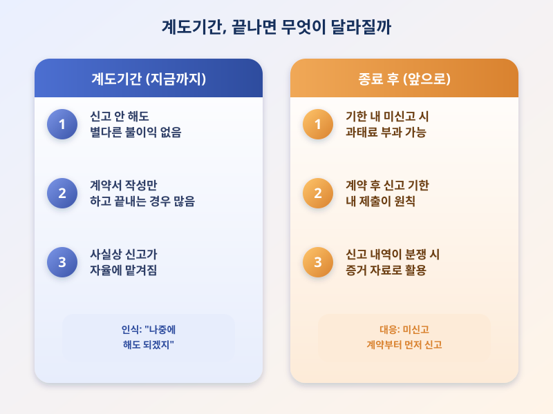

# 전월세신고제 계도기간 종료 임박, 미신고 시 과태료 현실화되나

  

전월세 계약을 맺을 때마다 꼭 챙겨야 하는 절차 중 하나로 전월세신고제가 있다. 임대차 계약을 체결하면 일정 기간 안에 계약 내용을 관할 지자체에 신고하도록 하는 제도인데, 그동안은 계도기간이라는 이유로 신고를 미뤄도 별다른 불이익이 없었다. 하지만 계도기간 종료가 임박했다는 소식이 나오면서, 이제는 신고를 미루면 실제로 과태료를 물게 될 수 있다는 우려가 커지고 있다.

전월세신고제는 보증금과 월세 등 계약의 핵심 정보를 신고하도록 하는 제도로, 임대인과 임차인 모두에게 신고 의무가 있다. 계도기간이 여러 차례 연장되면서 '신고하지 않아도 괜찮다'는 인식이 널리 퍼진 것이 사실이다. 그러나 이 제도가 본래 목표로 삼은 임대차 시장 정보의 투명한 공개, 즉 세입자들이 실제 시세를 가늠할 수 있는 데이터를 축적한다는 취지를 살리려면 신고율을 끌어올리는 것이 불가피하다는 지적이 나온다.

  

계도기간이 끝나면 신고 의무를 지키지 않은 임대인과 임차인은 신고 지연 정도에 따라 과태료를 부과받을 수 있다. 다만 구체적인 부과 기준과 시행 시점은 지역과 정책 발표에 따라 달라질 수 있으므로, 계약을 앞두고 있거나 이미 신고를 미뤄둔 경우라면 관할 지자체나 정부 발표를 통해 최신 내용을 직접 확인하는 것이 안전하다.

전월세신고제는 번거롭게 느껴질 수 있지만, 계약 내용을 공적으로 남겨두면 이후 분쟁이 생겼을 때 중요한 증거 자료로 활용할 수 있다는 장점도 있다. 계도기간 종료가 다가오는 지금, 아직 신고하지 않은 계약이 있다면 미루지 말고 신고 절차부터 먼저 챙겨보는 것이 좋겠다.

※ 이 초안은 AI가 생성했습니다. 게시 전 수치·정책 내용의 사실관계를 반드시 확인하세요.
