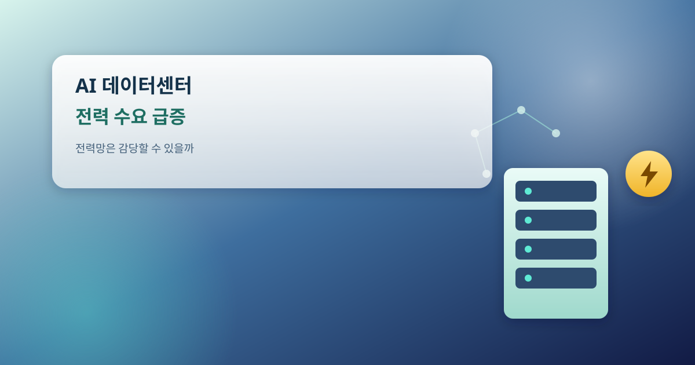
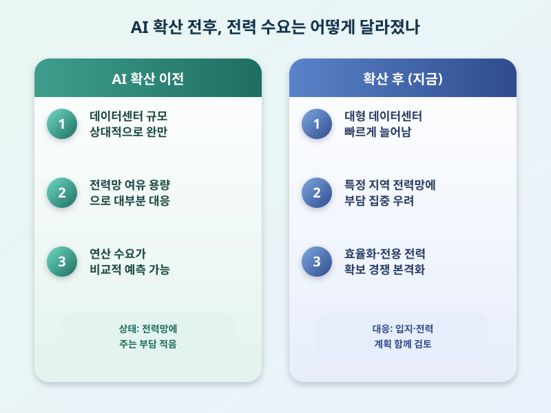

# AI 데이터센터 전력 수요 급증, 전력망은 감당할 수 있을까

  

최근 생성형 AI 서비스가 빠르게 확산되면서, 이를 뒷받침하는 데이터센터의 전력 소비량도 가파르게 늘고 있다는 소식이 자주 들린다. 챗봇이나 이미지 생성 같은 서비스를 처리하려면 많은 연산이 필요한데, 서버와 GPU가 모여 있는 데이터센터는 작동 자체는 물론 발열을 식히는 냉각 과정에서도 막대한 전기를 쓴다. AI 모델이 커지고 이용자가 늘수록 전력 수요는 앞으로도 계속 늘어날 것으로 보인다.

문제는 이 늘어난 수요를 기존 전력망이 그대로 받아낼 수 있느냐는 점이다. 데이터센터 한 곳이 중소도시 수준의 전력을 쓴다는 이야기도 나오는데, 이런 대형 시설이 특정 지역에 몰리면 그 지역 전력 설비에 부담이 쏠릴 수 있다. 전력이 부족해지면 산업체나 가정이 쓸 전기 수급 계획에도 영향을 줄 수 있어, 데이터센터 유치와 전력 수급 안정을 함께 고려해야 하는 과제가 떠오르고 있다.

  

이런 우려에 대응해 여러 움직임도 나타나고 있다. 운영사들은 전력 효율이 높은 반도체와 냉각 방식을 도입해 전기를 덜 쓰는 방향으로 기술을 개선하고 있고, 재생에너지나 소형모듈원전(SMR) 같은 전력 공급원을 데이터센터 전용으로 확보하려는 시도도 이어지고 있다. 국내에서도 데이터센터 입지와 전력 공급 계획을 함께 검토하는 방안이 논의되고 있다는 소식이 들린다.

AI가 주는 편리함 뒤에는 이렇게 눈에 잘 보이지 않는 전력 소비라는 비용이 자리하고 있다. 장기적으로는 전기요금이나 전력 공급 안정성에도 영향을 줄 수 있는 문제인 만큼, AI 산업 성장과 전력 인프라 확충을 함께 논의해야 할 시점이다. 구체적인 전력 소비량이나 투자 규모는 발표 시점과 기관마다 다를 수 있으니, 참고 자료를 통해 직접 확인하는 것이 좋겠다.

※ 이 초안은 AI가 생성했습니다. 게시 전 수치·정책 내용의 사실관계를 반드시 확인하세요.
