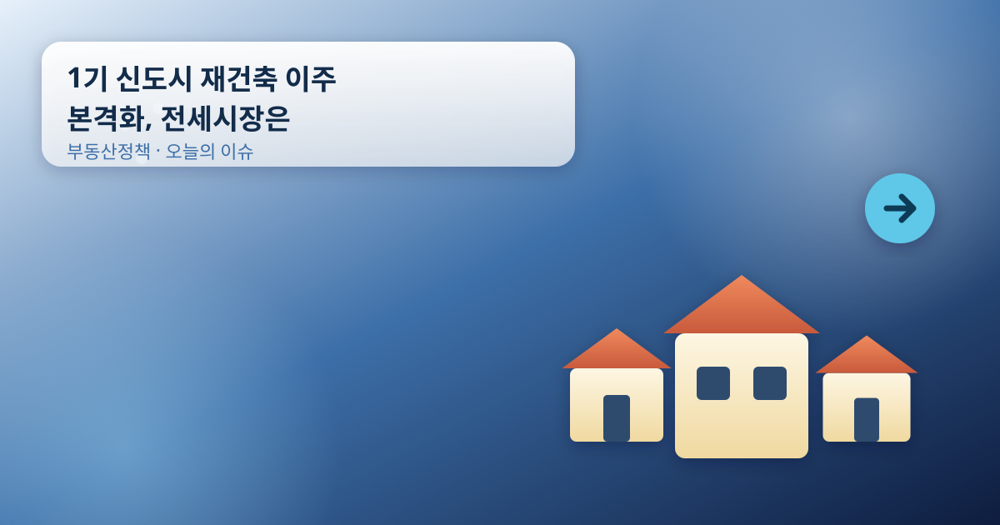
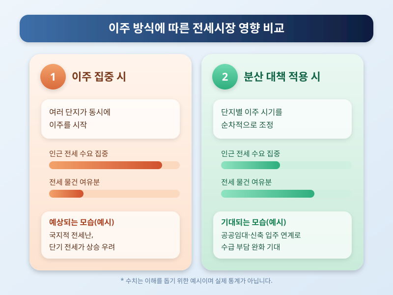

# 1기 신도시 재건축 이주 본격화, 전세시장은 괜찮을까

  

분당, 평촌, 산본, 중동, 일산 등 1기 신도시의 재건축 선도지구 사업이 속도를 내면서, 올해부터 본격적인 이주가 시작되는 단지들이 하나둘 늘고 있다는 소식이 이어지고 있다. 노후 아파트를 새로 짓는다는 점에서는 반길 만한 변화지만, 동시에 수천 가구가 한꺼번에 집을 비우고 다른 곳으로 옮겨가야 한다는 현실적인 문제도 함께 떠오르고 있다.

이주가 본격화되면 가장 먼저 영향을 받는 곳은 인근 전세시장이다. 한 단지에서 수천 세대가 동시에 이주 수요를 쏟아내면, 주변 지역의 전세 물건이 한꺼번에 줄어들고 전세가가 단기적으로 오를 수 있다는 우려가 꾸준히 제기된다. 특히 재건축 대상 단지와 생활권이 겹치는 인근 신도시나 구도심 지역은 이주 수요를 그대로 흡수해야 하는 처지라, 전세난이 국지적으로 심해질 가능성이 있다.

  

이런 우려를 의식해 정부와 지자체도 이주 수요를 시간과 지역에 분산시키는 방안을 검토하고 있는 것으로 알려졌다. 단지별로 이주 시기를 순차적으로 조정하거나, 인근 공공임대나 신축 단지의 입주 물량을 이주 시점에 맞춰 공급하는 식의 대응이 논의되고 있다. 다만 실제 이주가 몰리는 구간에서는 이런 대책이 체감 속도를 따라가지 못할 수 있다는 지적도 함께 나온다.

1기 신도시 재건축은 노후 주거지를 정비한다는 장기적인 의미가 크지만, 그 과정에서 전세시장이 흔들리면 당장 이사를 계획하는 세입자나 인근 거주자들에게는 부담으로 이어질 수 있다. 재건축 대상 단지 인근에서 전세를 구하거나 계약을 갱신할 계획이 있다면, 해당 단지의 이주 일정과 지역 전세 동향을 미리 확인해보는 것이 좋겠다. 구체적인 이주 시기나 전세가 변동 폭은 지역과 단지마다 다를 수 있으니, 실제 수치는 공식 발표와 현지 중개업소를 통해 직접 확인하길 권한다.

※ 이 초안은 AI가 생성했습니다. 게시 전 수치·정책 내용의 사실관계를 반드시 확인하세요.
