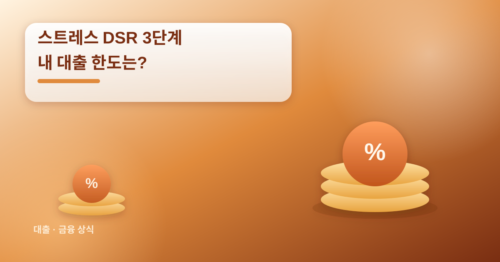
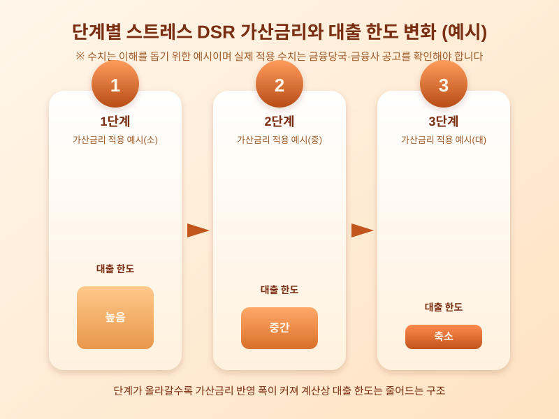

# 스트레스 DSR 3단계, 내 대출 한도에 미치는 영향은

  

주택담보대출이나 신용대출을 준비하는 사람들 사이에서 요즘 가장 자주 들리는 말 중 하나가 '스트레스 DSR'이다. 이미 시행 중인 제도이지만 단계적으로 기준이 강화되어 왔고, 다음 단계 시행 시점이 다가오면서 "내 대출 한도가 더 줄어드는 것 아니냐"는 걱정이 커지고 있다. 제도 자체는 낯설지 않지만, 단계가 올라갈수록 체감하는 영향은 달라질 수 있어 미리 구조를 이해해두는 것이 좋다.

스트레스 DSR은 대출 한도를 계산할 때 현재 금리에 일정한 가산금리를 더해 상환 능력을 평가하는 방식이다. 즉 지금 받는 금리가 낮더라도, 향후 금리가 오를 가능성을 미리 반영해 더 엄격한 기준으로 한도를 산정하는 것이다. 이는 금리 상승기에 상환 부담이 갑자기 커지는 상황을 방지하기 위한 안전장치로 도입되었다.

  

문제는 이 가산금리 적용 비율이 단계적으로 높아지는 구조라는 점이다. 단계가 올라갈수록 같은 소득과 같은 금리 조건이라도 계산상 한도는 더 낮게 나올 수 있다. 특히 변동금리나 혼합형 금리로 대출을 받으려는 경우 가산금리 반영 폭이 커지는 경향이 있어, 고정금리 대출과의 한도 차이가 더 벌어질 가능성도 있다. 주택담보대출뿐 아니라 일부 신용대출까지 적용 범위가 넓어지고 있다는 점도 함께 살펴볼 부분이다.

그렇다면 대출을 앞둔 입장에서는 무엇을 준비해야 할까. 우선 금융사 창구나 모바일 앱을 통해 본인의 예상 한도를 미리 조회해보는 것이 가장 확실하다. 같은 조건이라도 금리 유형(고정·변동·혼합형)에 따라 한도가 달라질 수 있으니 여러 상품을 비교해보는 것도 도움이 된다. 또한 제도 시행 시점과 적용 대상은 금융당국 발표나 거래 은행의 공지를 통해 수시로 바뀔 수 있으므로, 실제 대출을 신청하기 전 최신 공고를 반드시 확인해야 한다.

스트레스 DSR 강화는 결국 무리한 대출로 인한 위험을 줄이자는 취지에서 나온 제도다. 다만 그만큼 실수요자가 받을 수 있는 한도도 함께 줄어들 수 있으니, 자금 계획을 세울 때는 여유를 두고 여러 시나리오를 미리 점검해보는 것이 현명하다. 이 글에 포함된 가산금리나 한도 변화 수치는 설명을 위한 예시일 뿐이므로, 실제 적용되는 수치와 시행 일정은 반드시 금융당국 공고와 거래 금융사를 통해 직접 확인하길 권한다.

※ 이 초안은 AI가 생성했습니다. 게시 전 수치·정책 내용의 사실관계를 반드시 확인하세요.
