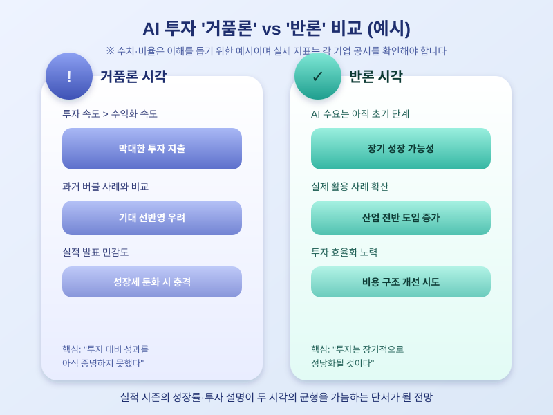

# 빅테크 AI 투자 '거품론', 실적 시즌이 분수령 될까

  

최근 몇 년간 빅테크 기업들은 AI 인프라에 천문학적인 금액을 쏟아부었다. 데이터센터 건설, GPU 확보, 전력망 투자 등 관련 지출 규모가 계속 커지는 가운데, "이 투자가 실제 수익으로 돌아오고 있느냐"는 질문이 다시 고개를 들고 있다. 특히 실적 발표 시즌이 다가올 때마다 AI 거품론과 이에 대한 반박이 교차하며 시장의 관심이 집중되는 모습이다.

AI 거품론의 핵심은 투자 속도와 수익화 속도 사이의 간극이다. 기업들은 차세대 모델 학습과 서비스 제공을 위해 막대한 자본을 데이터센터와 반도체에 투입하고 있지만, 이 투자가 실제 매출 증가나 이익 개선으로 얼마나 빠르게 연결되는지는 기업마다 차이가 크다. 일부에서는 과거 닷컴버블처럼 과도한 기대가 먼저 반영된 것 아니냐는 우려를 제기하고, 다른 한편에서는 AI 수요가 아직 초기 단계일 뿐이며 투자는 장기적으로 정당화될 것이라는 반론도 만만치 않다.

  

이런 가운데 실적 발표 시즌은 거품론 공방의 중요한 분수령으로 여겨진다. 투자자들은 각 기업이 AI 관련 매출과 투자 효율성을 어떻게 설명하는지, 그리고 향후 투자 계획을 늘리는지 줄이는지를 주의 깊게 살펴본다. 한 번의 실적 발표로 거품 여부가 확정되는 것은 아니지만, 예상치를 밑도는 성장세나 투자 축소 신호가 나올 경우 시장이 민감하게 반응할 가능성이 크다.

일반 투자자나 소비자 입장에서도 이 흐름을 지켜볼 필요가 있다. AI 관련주에 대한 관심이 높은 만큼, 특정 기업의 실적이나 투자 계획 변화가 관련 산업 전반에 영향을 줄 수 있기 때문이다. 다만 이 글에서 언급한 투자 규모나 성장률 등은 논의의 흐름을 설명하기 위한 예시일 뿐이므로, 실제 투자 금액이나 실적 지표는 각 기업의 공시와 실적발표 자료를 통해 직접 확인하는 것이 바람직하다.

AI 거품론은 쉽게 결론 나지 않을 주제다. 그러나 투자와 수익화 사이의 균형을 가늠해볼 수 있는 실적 시즌이 다가오는 지금, 관련 소식을 주의 깊게 지켜보는 것은 AI 산업의 흐름을 이해하는 데 도움이 될 것이다.

※ 이 초안은 AI가 생성했습니다. 게시 전 수치·정책 내용의 사실관계를 반드시 확인하세요.
