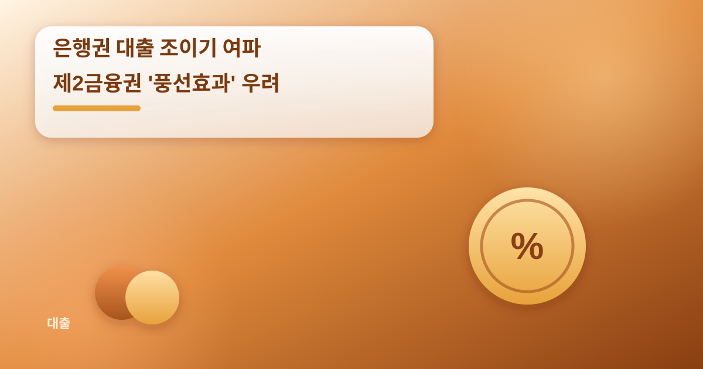
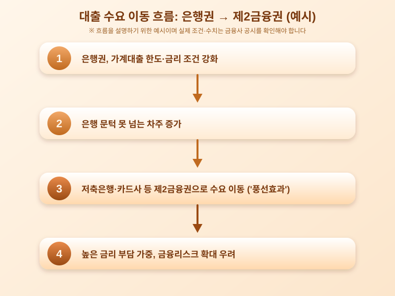

# 은행권 대출 조이기 여파, 제2금융권 '풍선효과' 우려 커진다

  

최근 은행들이 가계대출 관리를 강화하면서 주택담보대출과 신용대출의 문턱이 전반적으로 높아지고 있다. 그런데 이런 흐름이 이어지자 상대적으로 규제가 느슨한 저축은행, 카드사, 캐피탈사 등 제2금융권으로 대출 수요가 옮겨가는 '풍선효과'에 대한 우려가 다시 고개를 들고 있다. 은행 문턱을 넘지 못한 차주들이 금리가 더 높은 제2금융권으로 밀려나면서, 전체 가계부채 관리의 실효성과 서민층의 상환 부담이 동시에 문제로 떠오르는 모습이다.

풍선효과라는 표현이 익숙할 만큼, 이런 현상은 가계부채 대책이 나올 때마다 반복적으로 지적돼 온 구조적 문제다. 은행권에서 대출 한도를 조이거나 금리를 올리면 당장 급전이 필요한 사람들은 대안을 찾아 제2금융권 문을 두드리게 된다. 문제는 제2금융권 대출이 대체로 은행보다 금리가 높고 상환 조건도 더 빡빡한 경우가 많아, 상환 능력이 상대적으로 취약한 차주일수록 부담이 가중될 수 있다는 점이다. 이는 결국 개별 가구의 재무 건전성뿐 아니라 금융시장 전반의 리스크로 번질 가능성도 배제할 수 없다.

  

금융당국도 이런 흐름을 예의주시하며 제2금융권에 대한 모니터링과 관리 방안을 함께 들여다보고 있는 것으로 알려져 있다. 다만 은행권과 제2금융권을 동시에, 또 촘촘하게 관리하는 것은 생각보다 쉽지 않은 과제다. 한쪽을 조이면 다른 쪽으로 수요가 몰리는 '풍선'의 특성상, 정책이 한 걸음 늦게 따라가는 경우가 많기 때문이다. 이 때문에 일부에서는 업권별 규제 격차를 줄이는 통합적 접근이 필요하다는 지적도 나온다.

실수요자 입장에서는 당장 대출이 필요한 상황이라면 금리나 한도 조건을 꼼꼼히 비교하고, 자신의 상환 능력을 객관적으로 점검하는 자세가 더욱 중요해진 시점이다. 특히 제2금융권 상품은 금리 구조나 부대조건이 은행과 다를 수 있으므로, 단순히 승인 가능성만 보고 선택하기보다는 전체 상환 계획을 먼저 세워보는 것이 바람직하다. 다만 이 글에서 언급한 금리나 대출 조건 등은 일반적인 설명을 위한 예시이므로, 실제 수치는 각 금융사의 공시자료를 통해 확인해야 한다.

가계부채 관리는 어느 한 업권만 조인다고 해결되지 않는 문제라는 점이 이번 풍선효과 논란을 통해 다시 한번 드러나고 있다. 은행과 제2금융권을 아우르는 균형 잡힌 정책 설계가 이뤄질 수 있을지, 앞으로의 흐름을 지켜볼 필요가 있다.

※ 이 초안은 AI가 생성했습니다. 게시 전 수치·정책 내용의 사실관계를 반드시 확인하세요.
