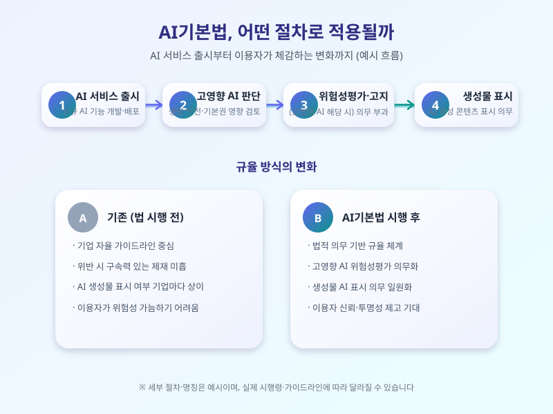

# AI기본법 시행이 다가온다, 국내 AI 기업과 우리가 알아둘 것들

  

국내 첫 AI 전담 법률인 AI기본법 시행 시기가 점차 가까워지면서, 그동안 가이드라인 수준에 머물러 있던 AI 관련 규율이 실제 법적 의무로 바뀌는 전환점을 맞고 있다. 그동안 해외 빅테크와 스타트업들이 비교적 자율적으로 AI 서비스를 내놓던 분위기에서, 이제는 국내에서도 일정 기준을 넘는 AI 시스템에 투명성과 안전성 확보 의무가 본격적으로 부과될 예정이어서 기업과 이용자 모두의 관심이 쏠리고 있다.

법의 핵심은 사람의 생명·안전이나 기본권에 큰 영향을 줄 수 있는 '고영향 AI'를 따로 분류하고, 이런 시스템을 운영하는 기업에게 위험성 평가와 이용자 고지, 안전성 확보 조치 등의 의무를 지우는 데 있다. 또한 생성형 AI로 만든 결과물에는 AI가 생성했다는 사실을 표시하도록 하는 조항도 포함되어 있어, 앞으로는 글이나 이미지, 음성 콘텐츠에서 AI 제작 여부를 구분하는 표시를 더 자주 보게 될 가능성이 크다.

  

이런 흐름은 이미 시행 중인 유럽연합의 AI법과 방향은 비슷하지만, 처벌 수준이나 적용 범위, 유예기간 등에서는 국내 상황에 맞춘 차이도 있을 것으로 보인다. 특히 스타트업이나 중소 AI 기업들은 대응 인력과 예산이 충분하지 않아, 규제 준수 부담이 사업 속도에 영향을 줄 수 있다는 우려도 함께 나오고 있다. 반면 일정한 규율이 자리 잡으면 이용자 신뢰가 높아져 장기적으로는 시장 성장에 도움이 될 거라는 기대도 있다.

아직 세부 시행령과 가이드라인이 확정되는 과정에 있어, 실제 기업 현장에 적용되는 기준은 앞으로 조금씩 달라질 수 있다. 다만 AI 서비스를 이용하는 입장에서는 콘텐츠의 AI 생성 여부 표시나 고지 문구가 눈에 띄게 늘어날 것이라는 점 정도는 미리 알아두면 좋을 듯하다. 기업 입장에서도 규제를 부담으로만 볼 것이 아니라, 신뢰 확보라는 기회로 접근하는 시각이 필요한 시점이다.

※ 이 초안은 AI가 생성했습니다. 게시 전 수치·정책 내용의 사실관계를 반드시 확인하세요.
