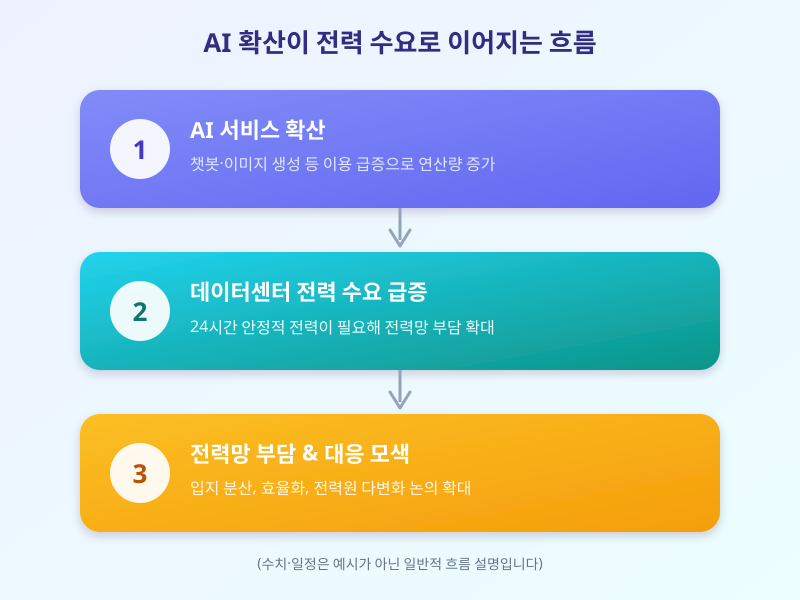

# AI가 삼키는 전력, 데이터센터발 전력난이 다가온다

  

AI 서비스 확산 속도가 빨라지면서, 정작 AI를 뒷받침하는 데이터센터의 전력 소비량이 예상보다 훨씬 빠르게 늘고 있다는 우려가 커지고 있다. 챗봇이나 이미지 생성 같은 서비스 하나를 돌리는 데도 상당한 연산이 필요한데, 이런 연산을 처리하는 서버와 냉각 장치가 끊임없이 전기를 먹어치우기 때문이다. 처음에는 IT 업계만의 문제로 여겨졌지만, 이제는 전력망 전체의 안정성과 일반 가정의 전기요금에까지 영향을 줄 수 있는 사안으로 번지고 있다.

국내에서도 대규모 데이터센터를 새로 짓겠다는 계획이 잇따르면서, 특정 지역에 전력 수요가 집중될 경우 기존 전력망이 이를 감당할 수 있을지에 대한 의문이 제기된다. 데이터센터는 24시간 안정적으로 전력을 끌어다 써야 하는 특성이 있어, 일반적인 공장이나 상업시설보다 전력 계통에 미치는 부담이 크다는 지적도 나온다. 여기에 신규 발전·송전 설비를 짓는 데는 상당한 시간이 걸리는 반면, AI 서비스 확장 속도는 그보다 훨씬 빠르다는 점도 문제로 꼽힌다.

  

전력 공급이 수요를 따라가지 못하면 결국 그 부담은 전기요금 인상이나 일부 지역의 전력 공급 우선순위 조정 형태로 소비자와 기업에게 돌아올 가능성이 있다. 해외에서는 데이터센터 운영사가 직접 발전 시설을 확보하거나, 재생에너지와 원자력 등 다양한 전력원을 조합해 안정적인 공급망을 마련하려는 움직임이 이미 나타나고 있다. 국내에서도 데이터센터 입지를 전력 여유가 있는 지역으로 분산하거나, 에너지 효율이 높은 서버와 냉각 기술을 도입하는 등의 대응이 함께 논의되고 있다.

AI 기술이 가져올 편리함 못지않게, 그 뒤에서 늘어나는 전력 수요를 어떻게 감당할지는 앞으로 산업계와 정부가 함께 풀어야 할 숙제로 보인다. 당장 개인이 할 수 있는 일은 많지 않지만, AI 서비스 확산과 전력·에너지 정책이 서로 맞물려 돌아간다는 점을 알아두면 관련 뉴스를 이해하는 데 도움이 될 것이다.

※ 이 초안은 AI가 생성했습니다. 게시 전 수치·정책 내용의 사실관계를 반드시 확인하세요.
