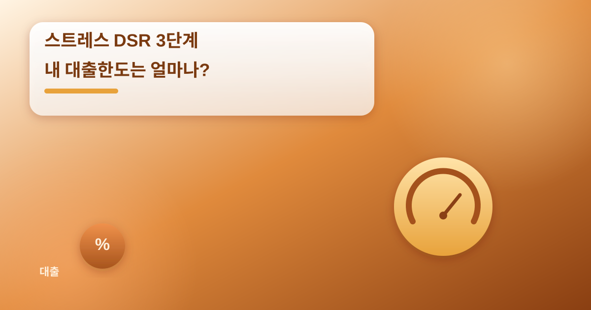
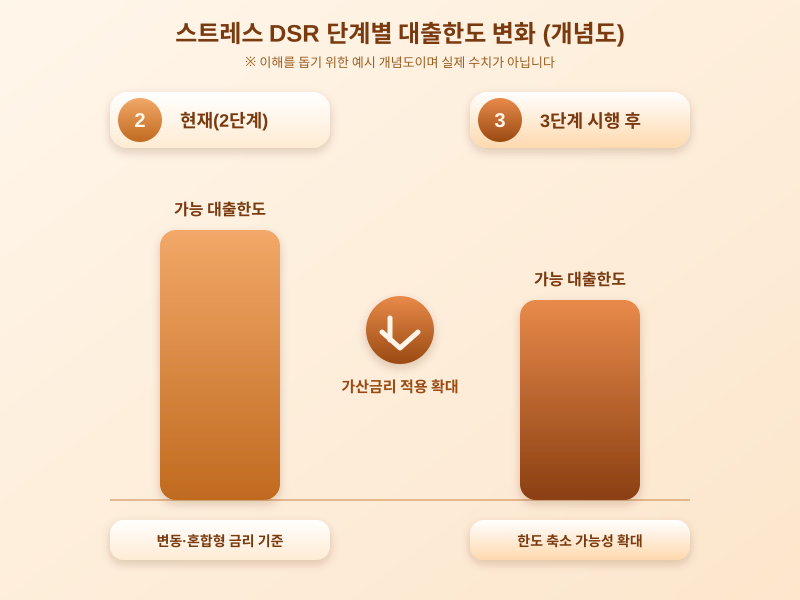

# 스트레스 DSR 3단계, 내 대출한도는 얼마나 줄어들까

  

최근 금융권에서 가장 자주 언급되는 단어 중 하나가 '스트레스 DSR'이다. 가계대출의 상환 능력을 더 엄격하게 평가하기 위해 단계적으로 도입된 이 제도가 다음 단계 시행을 앞두고 있다는 소식이 전해지면서, 집을 사거나 전세자금을 마련하려는 사람들 사이에서 관심이 커지고 있다. 대출한도가 예전보다 줄어들 수 있다는 우려가 현실로 다가오는 분위기다.

스트레스 DSR은 실제 적용되는 금리에 일정한 가산금리를 더해 상환능력을 평가하는 방식이다. 즉 지금 당장의 낮은 금리만 보고 대출한도를 산정하지 않고, 향후 금리가 오를 가능성까지 미리 반영해 더 보수적으로 한도를 계산하는 것이다. 단계가 올라갈수록 이 가산금리 적용 범위가 넓어지고 수준도 높아지는 구조여서, 같은 소득이라도 받을 수 있는 대출금액은 이전 단계보다 줄어들 가능성이 크다.

  

특히 영향을 크게 받는 쪽은 변동금리나 혼합형 대출을 이용하는 실수요자다. 고정금리 대출은 상대적으로 가산금리 적용 부담이 덜한 구조이기 때문에, 이번 단계 시행을 계기로 금리 유형을 다시 고민하는 사람들이 늘어날 것으로 보인다. 또한 생애 첫 집 마련을 준비하던 사람이라면, 원하는 금액만큼 대출이 나오지 않아 계획을 다시 짜야 하는 상황도 생길 수 있다.

문제는 이런 제도 변화가 단기간에 대출 수요자들의 자금 조달 계획을 크게 흔들 수 있다는 점이다. 이미 계약을 진행 중인 사람이라면 잔금 시점의 대출한도가 처음 상담받았을 때와 달라질 수 있고, 새로 대출을 알아보는 사람이라면 희망하는 금액과 실제 승인 가능한 금액 사이의 간극을 미리 점검해야 한다. 금융사마다 적용 시점이나 세부 기준에 차이가 있을 수 있다는 점도 유의할 부분이다.

결국 스트레스 DSR 3단계 시행을 앞둔 지금 시점에서 할 수 있는 가장 현실적인 대응은, 본인의 소득과 기존 대출을 기준으로 미리 한도를 가늠해보고 금리 유형과 상환 계획을 다시 점검하는 것이다. 제도가 바뀌는 과정에서 생기는 혼란을 줄이려면, 변경 내용을 꾸준히 확인하는 자세가 필요한 시점이다.

※ 이 초안은 AI가 생성했습니다. 게시 전 수치·정책 내용의 사실관계를 반드시 확인하세요.
