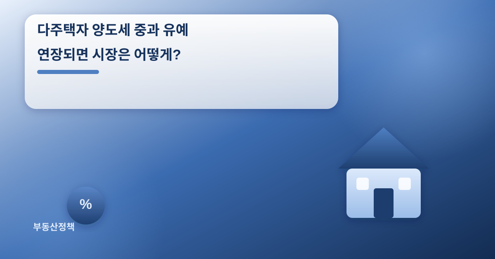
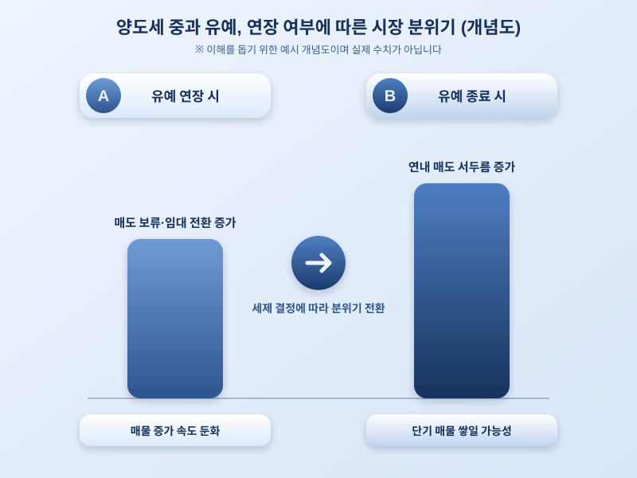

# 다주택자 양도세 중과 유예, 연장되면 시장은 어떻게 움직일까

  

연말이 다가오면 늘 반복되는 세제 이슈 중 하나가 다주택자에 대한 양도소득세 중과 유예 조치의 연장 여부다. 유예 조치가 끝나면 다시 중과세율이 적용될 수 있다는 소식이 전해지면서, 집을 여러 채 보유한 사람들 사이에서 연내 매도 여부를 다시 고민하는 분위기가 커지고 있다. 이 문제는 단순히 특정 계층의 세금 문제를 넘어, 매물 공급과 거래량 전반에 영향을 줄 수 있어 시장 참여자 모두가 주목하는 주제다.

양도세 중과 유예는 다주택자가 집을 팔 때 추가로 부과되는 중과세율을 일정 기간 면제해주는 조치다. 이 제도가 시행된 이후 다주택자들의 매도가 비교적 수월해지면서 매물이 늘어나는 효과가 있었다는 평가가 나온다. 반대로 유예가 종료되면 세 부담이 다시 커지기 때문에, 매도를 서두르거나 아예 매도를 보류하고 임대로 전환하는 선택이 늘어날 수 있다는 전망도 함께 제기된다.

  

문제는 이런 세제 변화가 시장 전반의 매물량과 가격 흐름에 영향을 줄 수 있다는 점이다. 유예가 연장되지 않을 경우 연말까지 매도를 서두르는 다주택자가 늘면서 일시적으로 매물이 쌓일 가능성이 있고, 반대로 연장이 확정되면 매도를 미루는 쪽으로 분위기가 바뀔 수 있다. 실수요자 입장에서는 이러한 변화가 매물 선택의 폭이나 가격 협상력에 직접 영향을 줄 수 있어 눈여겨볼 필요가 있다.

결국 다주택자 양도세 중과 유예의 연장 여부는 세금 정책을 넘어 주택 거래 시장 전체의 분위기를 좌우할 수 있는 변수다. 집을 사려는 사람이든 팔려는 사람이든, 유예 조치의 최종 결정과 시행 시점을 미리 확인하고 자신의 상황에 맞는 거래 시점을 신중하게 판단하는 자세가 필요한 시점이다.

※ 이 초안은 AI가 생성했습니다. 게시 전 수치·정책 내용의 사실관계를 반드시 확인하세요.
