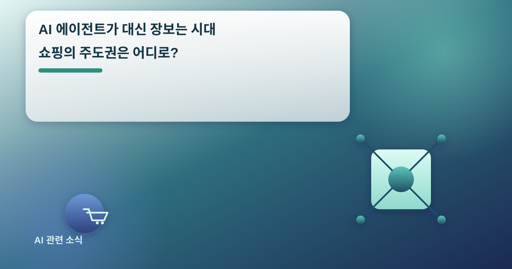
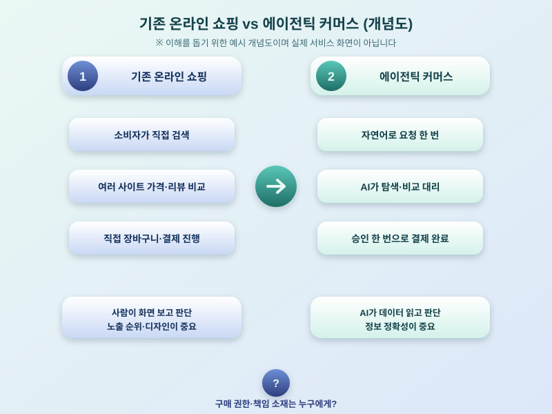

# AI 에이전트가 대신 장보는 시대, 쇼핑의 주도권은 어디로 가나

  

최근 들어 사람 대신 AI가 상품을 검색하고 비교하고 결제까지 진행하는 '에이전틱 커머스'가 빠르게 화두로 떠오르고 있다. 챗봇에게 원하는 조건을 말하면 AI가 여러 쇼핑몰을 돌며 조건에 맞는 상품을 찾아 장바구니에 담고, 사용자의 승인만 받아 결제를 마무리하는 방식이다. 단순히 상품을 추천해주는 수준을 넘어 구매 행위 자체를 대리하는 단계로 넘어가면서, 유통업계와 소비자 모두가 이 변화를 주목하고 있다.

기존의 온라인 쇼핑은 소비자가 직접 여러 사이트를 오가며 가격과 리뷰를 비교하는 과정을 거쳤다. 반면 에이전틱 커머스에서는 이 탐색 과정을 AI가 대신 수행한다. 소비자는 원하는 조건을 자연어로 한 번 전달하면 되고, AI는 여러 쇼핑 플랫폼의 상품 정보를 비교해 적합한 선택지를 제시한다. 이 과정에서 소비자가 미리 결제 정보를 AI 플랫폼에 등록해두면, 승인 한 번으로 주문부터 결제까지 끝나는 구조가 만들어진다.

  

이런 변화는 유통업계에 새로운 숙제를 던진다. 지금까지 플랫폼들은 사람의 눈에 잘 띄는 화면 배치나 검색 노출 순위로 구매를 유도해왔지만, AI 에이전트가 구매를 대리하면 이런 전략이 통하지 않을 수 있다. 오히려 AI가 상품 정보를 정확히 읽어낼 수 있도록 데이터를 정리하고 노출하는 능력이 새로운 경쟁력으로 떠오를 전망이다. 동시에 AI의 결제 권한 범위나 오류 발생 시 책임 소재 같은 소비자 보호 장치도 함께 논의돼야 한다는 목소리가 나온다.

에이전틱 커머스는 아직 초기 단계이지만, 쇼핑의 주도권이 사람에서 AI로 옮겨가는 흐름을 보여주는 신호로 읽힌다. 소비자 입장에서는 편리함이 커지는 만큼, AI에게 어디까지 구매 권한을 맡길지, 그리고 결제 과정에서 발생할 수 있는 문제에 어떻게 대응할지를 함께 고민해볼 시점이다.

※ 이 초안은 AI가 생성했습니다. 게시 전 수치·정책 내용의 사실관계를 반드시 확인하세요.
