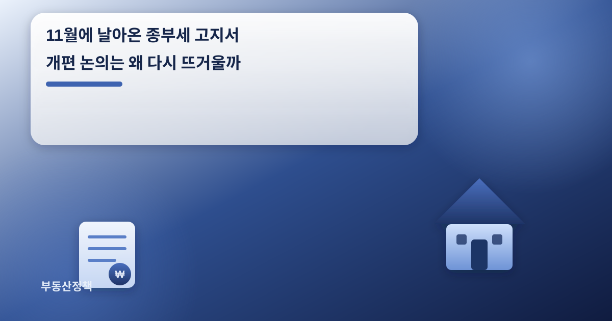
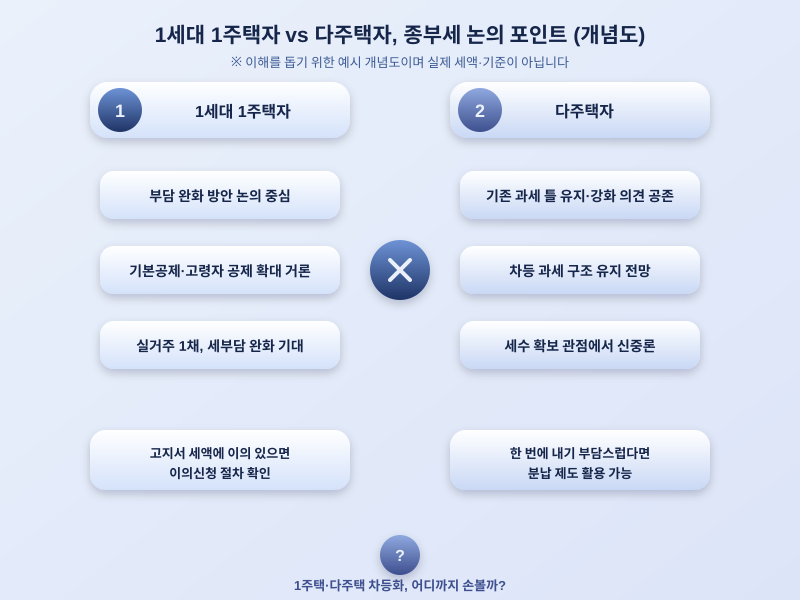

# 11월에 날아온 종합부동산세 고지서, 개편 논의가 다시 뜨거운 이유

  

매년 11월이면 전국의 주택 보유자들에게 종합부동산세, 줄여서 종부세 고지서가 발송된다. 올해도 고지서를 받아본 사람들 사이에서 세 부담에 대한 체감이 커지는 가운데, 정치권과 정부 안에서는 종부세 제도를 다시 손봐야 한다는 목소리가 나오고 있다. 특히 집 한 채만 보유한 1세대 1주택자의 부담을 완화해야 한다는 논의가 재점화되면서, 보유세 전반에 대한 관심이 높아지는 시점이다.

종부세는 일정 기준을 넘는 고액의 주택이나 토지를 보유한 사람에게 부과되는 세금으로, 매년 6월 1일을 기준으로 보유 현황을 따져 11월에 고지서가 나가는 구조다. 다주택자뿐 아니라 집값이 오른 지역에 거주하는 1주택자들도 과세 대상에 포함되는 경우가 늘면서, 본래 '고액 자산가 세금'으로 여겨졌던 종부세가 중산층까지 넓게 영향을 미친다는 지적이 꾸준히 제기돼 왔다.

  

이번에 다시 떠오른 개편 논의의 핵심은 1세대 1주택자에 대한 부담을 어떻게 더 낮출 것인가다. 공정시장가액비율을 조정하거나 기본공제 금액을 올리는 방안, 고령자·장기보유자에 대한 공제 혜택을 확대하는 방안 등이 함께 거론된다. 반면 다주택자에 대해서는 기존의 과세 틀을 유지하거나 오히려 강화해야 한다는 의견도 있어, 1주택자와 다주택자를 어떻게 차등화할지가 이번 논의의 관전 포인트로 꼽힌다. 세수 확보와 주택 시장 안정이라는 다른 목표 사이에서 균형을 찾아야 한다는 점도 논의를 복잡하게 만드는 요인이다.

아직 구체적인 법 개정안이 확정된 것은 아니지만, 고지서를 받아든 보유자라면 이번 논의의 방향을 눈여겨볼 필요가 있다. 고지된 세액이 실제 보유 현황과 다르다고 생각되면 이의신청 절차를 확인해볼 수 있고, 한 번에 내기 부담스러운 금액이라면 분납 제도를 활용하는 것도 방법이다. 제도가 앞으로 어떻게 바뀌든, 본인의 보유 주택 현황과 세액 산정 근거를 정확히 파악해두는 것이 가장 기본적인 대응이라 할 수 있다.

※ 이 초안은 AI가 생성했습니다. 게시 전 수치·정책 내용의 사실관계를 반드시 확인하세요.
