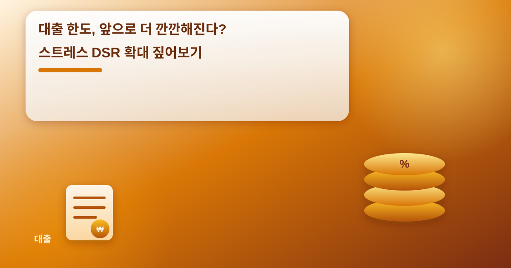
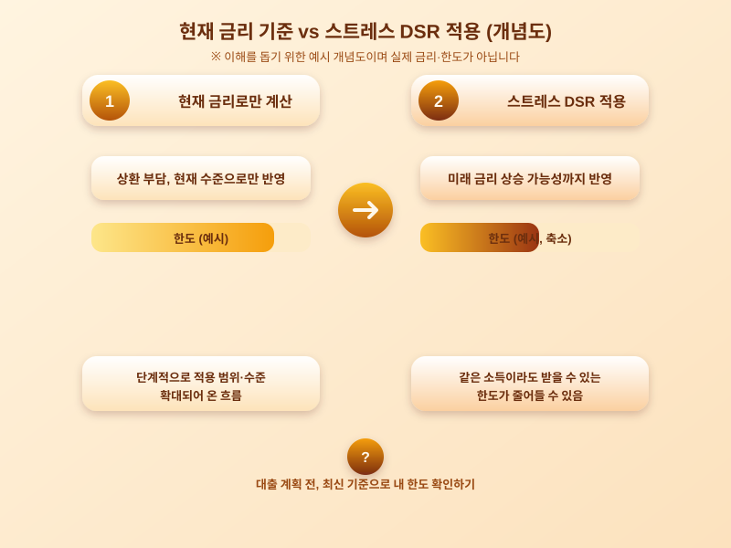

# 대출 한도, 앞으로 더 깐깐해진다? 스트레스 DSR 확대 짚어보기

  

최근 들어 대출을 알아보던 분들이라면 "예전보다 한도가 줄었다"는 이야기를 자주 듣게 됩니다. 가계대출 관리를 강화하는 기조가 이어지면서 대출 심사 기준이 점차 엄격해지고 있고, 그 핵심에는 '스트레스 DSR'이라는 제도가 자리하고 있습니다. 오늘은 이 제도가 무엇이고, 왜 계속 확대 적용되고 있는지, 그리고 대출을 계획 중인 분들이 무엇을 챙겨야 하는지 쉽게 풀어보겠습니다.

스트레스 DSR은 쉽게 말해 미래의 금리 상승 가능성까지 미리 감안해서 대출 한도를 계산하는 방식입니다. 현재 금리로만 상환 능력을 평가하면 나중에 금리가 오를 때 상환 부담이 커질 수 있다는 우려에서 도입됐습니다. 그래서 실제 적용 금리에 일정한 가산 금리를 더해 대출 한도를 산정하게 되고, 결과적으로 같은 소득이라도 과거보다 받을 수 있는 대출 금액이 줄어드는 효과가 나타납니다. 이 제도는 처음 도입된 이후 단계적으로 적용 범위와 수준이 확대되어 왔고, 적용 대상도 점점 넓어지는 흐름입니다.

  

이런 변화는 특히 실수요자, 즉 내 집 마련이나 전세자금 마련을 위해 대출이 꼭 필요한 사람들에게 체감도가 큽니다. 예전에 받을 수 있었던 한도와 지금의 한도가 달라질 수 있기 때문에, 미리 은행 상담을 통해 현재 기준으로 실제 한도가 얼마나 나오는지 확인해보는 과정이 중요해졌습니다. 또한 소득, 기존 보유 대출, 상환 방식 등에 따라 영향받는 정도가 다르므로, 단순히 "한도가 줄었다"는 소식만으로 미리 좌절하기보다는 본인의 상황에 맞춰 구체적으로 따져보는 태도가 필요합니다.

대출 규제는 앞으로도 가계부채 관리 차원에서 계속 조정될 가능성이 높습니다. 그래서 자금 계획을 세울 때는 최신 기준을 수시로 확인하고, 필요하다면 여러 금융기관의 상담을 받아 비교해보는 것이 현명합니다. 변화하는 제도 속에서도 내게 맞는 전략을 찾는 것이 결국 가장 중요한 포인트입니다.

※ 이 초안은 AI가 생성했습니다. 게시 전 수치·정책 내용의 사실관계를 반드시 확인하세요.
