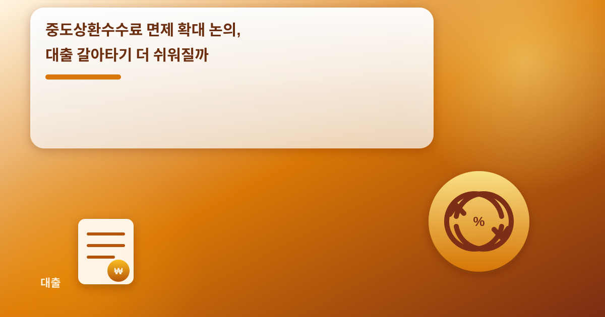
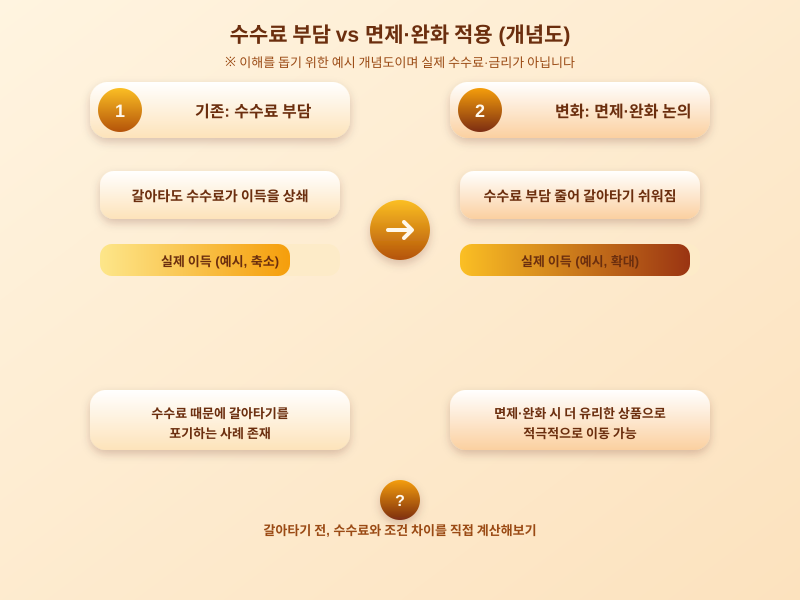

# 중도상환수수료 면제 확대 논의, 대출 갈아타기 더 쉬워질까

  

대출을 받고 나서 더 낮은 금리의 상품을 발견했는데도 "수수료 때문에 그냥 참는다"는 이야기를 주변에서 종종 듣게 됩니다. 바로 중도상환수수료 때문인데, 최근 이 수수료를 면제하거나 완화하자는 논의가 계속 거론되면서 대출 갈아타기가 한층 쉬워질 수 있다는 기대가 나오고 있습니다. 오늘은 중도상환수수료가 무엇인지, 왜 완화 논의가 나오는지, 그리고 대출을 옮기기 전에 무엇을 챙겨야 하는지 정리해보겠습니다.

중도상환수수료는 대출을 만기 전에 일부 또는 전부 갚을 때 금융기관에 추가로 내야 하는 비용입니다. 금융기관 입장에서는 예정된 이자 수익이 줄어드는 만큼 이를 보전하려는 목적으로 부과하는데, 문제는 이 수수료가 더 유리한 조건으로 옮기고 싶은 소비자의 발목을 잡는 경우가 많다는 점입니다. 특히 금리가 변동하는 시기에는 기존 대출과 새 대출의 조건 차이가 커질 수 있는데, 수수료 부담 때문에 갈아타기를 포기하는 사례가 적지 않습니다. 이런 배경에서 수수료를 면제하거나 부과 기간·비율을 완화하자는 목소리가 꾸준히 나오고 있습니다.

  

이러한 논의는 최근 활성화된 대환대출, 즉 기존 대출을 더 좋은 조건의 상품으로 옮기는 서비스와도 맞닿아 있습니다. 대환대출 플랫폼을 통해 금리를 비교하고 손쉽게 옮길 수 있게 되었지만, 중도상환수수료가 남아 있으면 실제로 옮겼을 때의 이득이 생각보다 줄어들 수 있습니다. 그래서 수수료 부담까지 함께 줄어든다면 소비자들이 더 적극적으로 유리한 상품을 찾아 나설 수 있는 환경이 만들어질 것으로 보입니다.

다만 아직 논의 단계인 내용이 많고, 금융기관이나 대출 종류에 따라 수수료 면제 여부와 조건은 제각각입니다. 따라서 당장 대출을 옮길 계획이 있다면 현재 가입한 대출의 수수료 면제 기간이 지났는지, 새로 옮길 상품의 금리와 조건이 수수료를 상쇄할 만큼 유리한지 꼼꼼히 따져보는 것이 중요합니다. 제도가 어떻게 바뀌든, 결국 내 상황에 맞춰 실제 득실을 계산해보는 습관이 가장 든든한 대비책이 될 것입니다.

※ 이 초안은 AI가 생성했습니다. 게시 전 수치·정책 내용의 사실관계를 반드시 확인하세요.
