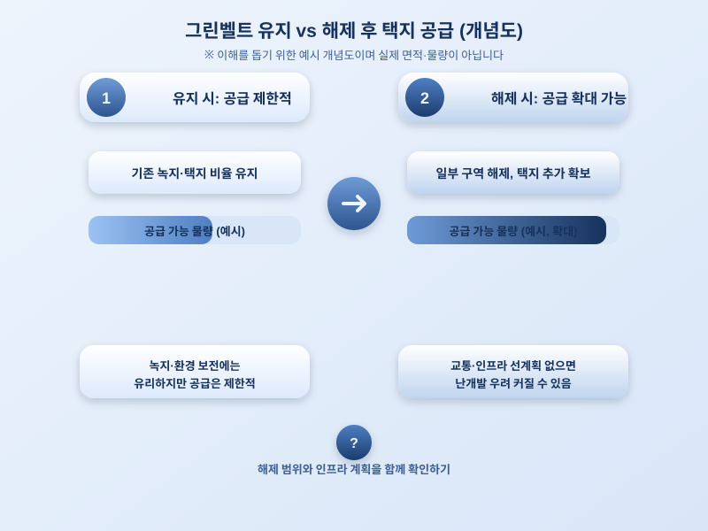

# 수도권 그린벨트 해제 추진, 주택공급 확대 효과 있을까

  

집값 안정을 위해서는 결국 공급을 늘려야 한다는 목소리가 끊이지 않는 가운데, 수도권 개발제한구역, 즉 그린벨트를 풀어 택지를 확보하자는 논의가 다시 수면 위로 올라오고 있습니다. 그린벨트 해제는 공급 대책이 나올 때마다 거론되는 단골 카드인데, 이번에는 어떤 배경에서 다시 논의되고 있는지, 그리고 실제로 집값과 공급에 어떤 영향을 줄 수 있는지 살펴보겠습니다.

그린벨트는 도시의 무분별한 팽창을 막고 녹지를 보전하기 위해 오래전부터 유지되어 온 개발제한구역입니다. 그동안에도 주택공급이 부족할 때마다 일부 구역을 해제해 신도시나 공공주택을 짓는 방식으로 활용된 사례가 있었습니다. 최근에는 수도권 주택 수요가 특정 지역으로 몰리면서 공급 부족 우려가 다시 커지자, 그린벨트 해제를 통해 택지를 추가로 확보하자는 목소리가 다시 힘을 얻고 있습니다. 특히 교통이 편리하고 생활 인프라에 가까운 곳일수록 해제 요구가 거세지는 모습입니다.

  

그린벨트를 풀면 단기간에 상당한 규모의 택지를 확보할 수 있다는 점에서 공급 효과에 대한 기대가 적지 않습니다. 다만 녹지가 줄어드는 만큼 환경 훼손에 대한 우려도 함께 제기되고, 도로나 학교 같은 기반시설이 미리 갖춰지지 않으면 자칫 난개발로 이어질 수 있다는 지적도 나옵니다. 또한 해제 지역이 발표되는 순간부터 주변 토지와 주택 가격이 먼저 들썩이는 경우가 많아, 실제 공급으로 이어지기까지의 시차와 그 과정에서 생기는 부작용도 함께 고려해야 합니다.

결국 그린벨트 해제가 집값 안정으로 이어지려면 단순히 땅을 푸는 것을 넘어, 교통망과 생활 인프라가 함께 계획되고 실제 입주까지 속도감 있게 진행되는 것이 중요합니다. 내 집 마련을 준비하는 입장이라면 어느 지역이 해제 후보로 거론되는지, 그리고 공급 일정이 구체적으로 잡혀 있는지를 꾸준히 확인하면서 장기적인 관점으로 접근하는 것이 바람직합니다.

※ 이 초안은 AI가 생성했습니다. 게시 전 수치·정책 내용의 사실관계를 반드시 확인하세요.
