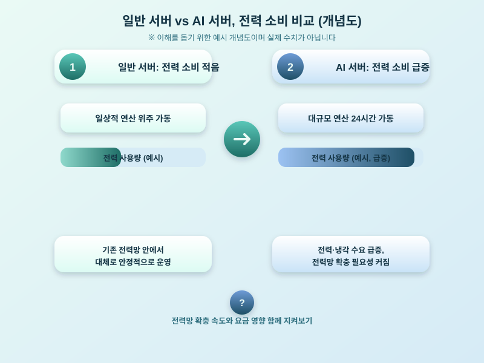

# AI 데이터센터발 전력난, 우리 전력망도 영향권일까

  

요즘 AI 서비스를 쓰다 보면 답변이 점점 빨라지고 똑똑해진다는 걸 느끼게 됩니다. 그런데 이 편리함 뒤에는 잘 보이지 않는 비용이 숨어 있습니다. 바로 거대한 AI 모델을 24시간 돌리는 데이터센터의 전력 소비입니다. 최근 해외에서는 AI 붐이 전력망에 주는 부담이 중요한 이슈로 떠올랐고, 국내에서도 비슷한 고민이 서서히 수면 위로 올라오고 있습니다.

AI 모델, 특히 거대언어모델을 학습하고 서비스하는 과정은 기존 서버와는 비교하기 어려울 정도로 많은 전력을 필요로 합니다. 수많은 고성능 연산 장치가 쉬지 않고 돌아가야 하고, 이 장치들이 뿜어내는 열을 식히는 데도 상당한 전력이 추가로 들어갑니다. 그러다 보니 글로벌 빅테크들은 데이터센터 부지를 고를 때 땅값보다 전력을 안정적으로, 그리고 충분히 끌어올 수 있는지를 더 중요하게 보는 경우가 많아졌습니다.

  

국내에서도 데이터센터를 유치하려는 지방자치단체들의 움직임이 활발한데, 막상 전력망을 어디까지 확충할 수 있느냐가 관건으로 떠오르고 있습니다. 데이터센터가 몰리는 지역에서는 전력 공급 설비 확충을 둘러싼 지역 주민과의 갈등, 발전소나 송전선로 추가 건설을 둘러싼 논의가 함께 진행되는 분위기입니다. 이런 흐름이 이어지면 결국 전체 전력 수급 계획과 요금 체계에도 영향을 줄 수밖에 없다는 우려가 나옵니다.

당장 개인이 체감할 정도의 변화는 아니더라도, AI 서비스 확산과 전력 수급 문제는 앞으로 계속 맞물려 돌아갈 가능성이 큽니다. 전기요금이나 전력 정책에 관심이 있다면, AI와 전력이라는 두 가지 흐름이 어떻게 연결되는지 한 번쯤 짚어보는 것도 의미가 있을 것입니다.

※ 이 초안은 AI가 생성했습니다. 게시 전 수치·정책 내용의 사실관계를 반드시 확인하세요.
