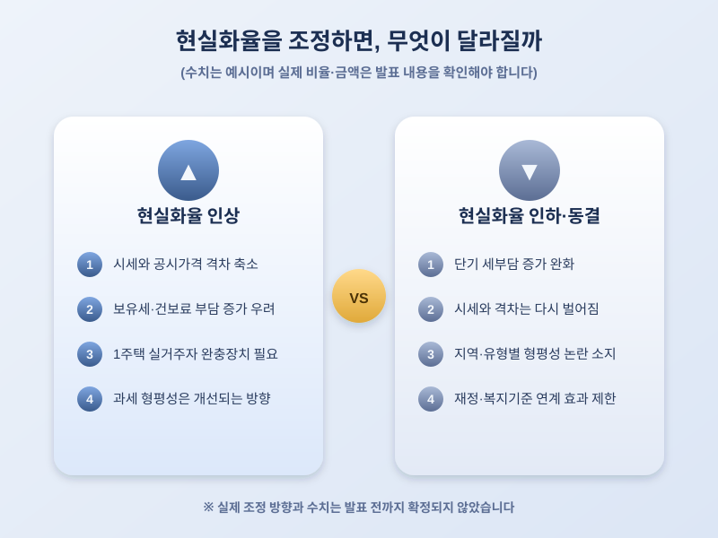

# 공시가격 현실화율 재조정 논의, 보유세 부담 어떻게 달라질까

  

연말이 다가오면 어김없이 등장하는 뉴스 중 하나가 내년도 공시가격 산정 기준을 둘러싼 논의입니다. 특히 공시가격을 실제 시세에 얼마나 가깝게 맞출지를 정하는 현실화율 조정 방향은 매년 이 시기마다 다시 화두로 떠오릅니다. 집을 소유한 사람이라면 공시가격이 보유세나 건강보험료 산정의 기준이 되는 만큼, 이번에는 어떤 방향으로 결정될지 관심이 쏠릴 수밖에 없습니다.

공시가격은 정부가 매년 발표하는 부동산의 적정 가격으로, 종합부동산세와 재산세 같은 보유세는 물론 건강보험 지역가입자의 보험료, 각종 복지제도의 소득·재산 기준에도 폭넓게 활용됩니다. 현실화율은 이 공시가격을 실제 시세에 얼마나 근접하게 반영할지를 정하는 비율인데, 그동안 집값 변동 폭이나 세부담 완충 필요성에 따라 올리고 내리는 논의가 반복되어 왔습니다. 현실화율을 높이면 시세와의 격차는 줄어들지만 세부담이 커질 수 있고, 반대로 낮추면 세부담은 줄어도 과세 형평성 논란이 생길 수 있어 매번 쉽지 않은 선택이 됩니다.

  

올해도 주택 유형별, 지역별로 시세 변동이 엇갈린 상황이라 일률적인 조정보다는 세부 기준을 어떻게 다듬을지가 관건으로 보입니다. 특히 1세대 1주택 실거주자나 은퇴 이후 소득이 줄어든 고령층의 경우, 공시가격 인상이 그대로 세부담 증가로 이어지면 부담이 커질 수 있어 완화 장치 적용 여부가 함께 논의되는 분위기입니다.

당장 공시가격 발표 전까지는 구체적인 숫자를 알기 어렵지만, 내가 보유한 주택의 공시가격이 어떤 기준으로 산정되는지, 보유세나 건보료에 어떤 영향을 줄 수 있는지는 미리 한 번쯤 점검해두는 것이 좋습니다. 특히 보유세 절세나 감면 혜택을 챙길 수 있는 제도가 있는지도 함께 살펴보면 도움이 될 것입니다.

※ 이 초안은 AI가 생성했습니다. 게시 전 수치·정책 내용의 사실관계를 반드시 확인하세요.
