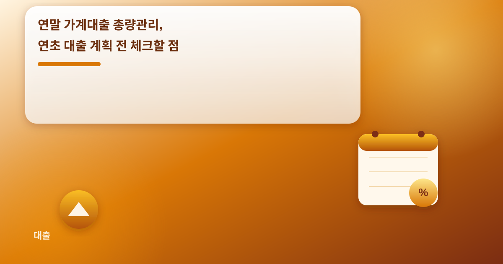
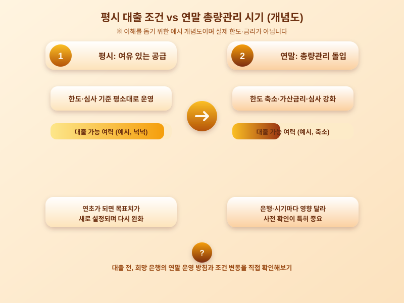

# 연말 가계대출 총량관리, 연초 대출 계획 세울 때 체크할 점

  

매년 11월에서 12월로 넘어가는 시기가 되면 은행권에서 어김없이 등장하는 이야기가 가계대출 총량관리입니다. 한 해 동안 쌓인 대출 증가분을 관리하기 위해 은행들이 연말로 갈수록 대출 한도를 조이거나 심사를 더 꼼꼼히 하는 흐름이 매년 반복되다 보니, 지금처럼 연말이 가까워지는 시점이면 대출을 계획하고 있던 사람들 사이에서 관심이 커지곤 합니다.

가계대출 총량관리란 은행이나 금융당국이 설정한 연간 대출 증가율 목표에 맞추기 위해, 한 해가 끝나갈 무렵 신규 대출 공급 속도를 조절하는 것을 말합니다. 목표치에 근접했거나 초과할 우려가 있는 은행일수록 연말에 가까워질수록 대출 한도를 낮추거나, 가산금리를 올리거나, 서류 심사 기준을 강화하는 방식으로 대응하는 경우가 많습니다. 이 때문에 같은 조건이라도 11월과 1월에 받는 대출의 한도나 금리가 달라질 수 있습니다.

  

문제는 이런 변화가 은행마다, 시기마다 다르게 나타나기 때문에 미리 확인하지 않으면 계획했던 자금 조달에 차질이 생길 수 있다는 점입니다. 특히 주택 구입이나 전세 자금처럼 큰 금액이 필요한 경우, 연말에 한도가 줄어들거나 승인이 늦어지면 계약 일정 자체가 흔들릴 수 있습니다. 반대로 연초가 되면 총량관리 목표가 새로 설정되면서 다시 문턱이 낮아지는 경향도 있어, 시기를 조절할 수 있다면 유리하게 활용할 여지도 있습니다.

따라서 지금 대출을 알아보고 있다면 희망하는 은행의 연말 대출 운영 방침이 바뀌었는지, 한도나 금리 조건에 변동이 있는지를 미리 확인해보는 것이 좋습니다. 또한 여러 금융사의 조건을 한 번에 비교해볼 수 있는 대출비교 서비스를 활용하면, 특정 은행의 총량관리 영향을 덜 받는 대안을 찾는 데에도 도움이 될 수 있습니다. 급하지 않다면 연초 상황을 지켜본 뒤 결정하는 것도 하나의 방법입니다.

※ 이 초안은 AI가 생성했습니다. 게시 전 수치·정책 내용의 사실관계를 반드시 확인하세요.
