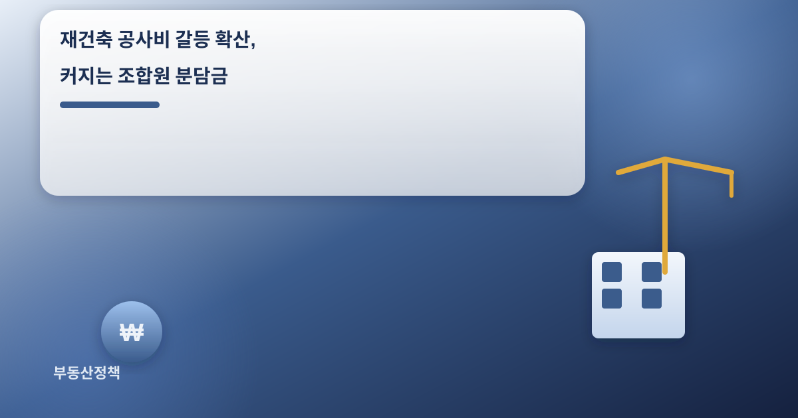
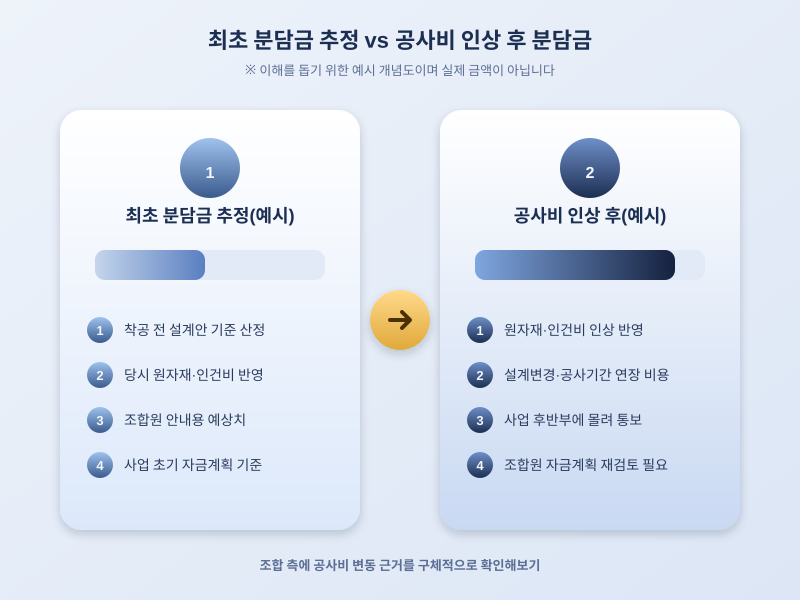

# 재건축 공사비 갈등 확산, 조합원 분담금 눈덩이처럼 커지는 이유

  

최근 전국 곳곳의 재건축·재개발 현장에서 조합과 시공사 간 공사비를 둘러싼 갈등이 잇따라 불거지고 있습니다. 착공 전 예상했던 공사비가 사업이 진행되는 동안 크게 늘어나면서, 조합원들이 추가로 부담해야 하는 분담금도 함께 커지는 모습입니다. 내 집 마련이나 재건축 투자를 고려하는 입장에서는 왜 이런 갈등이 반복되는지, 분담금이 어떤 식으로 늘어나는지 미리 알아두면 도움이 될 만한 시점입니다.

공사비가 처음 추정했던 금액보다 늘어나는 이유는 다양합니다. 원자재와 인건비가 사업 기간 중 계속 오르는 데다, 설계가 변경되거나 공사 기간이 늘어나면 그만큼 추가 비용이 발생합니다. 여기에 금융비용과 각종 부대비용까지 겹치면, 처음 조합원들에게 안내됐던 분담금 규모와 실제로 청구되는 금액 사이에 상당한 차이가 생길 수 있습니다. 문제는 이런 증가분이 사업 후반부에 몰려서 통보되는 경우가 많아, 조합원들이 자금 계획을 다시 짜야 하는 상황에 놓이기 쉽다는 점입니다.

  

공사비 갈등이 길어지면 사업 자체가 지연되는 부작용도 따라옵니다. 조합과 시공사가 합의에 이르지 못하면 공사가 중단되거나 입주 시점이 늦춰질 수 있고, 그 사이 금융비용이 또 늘어나는 악순환이 반복되기도 합니다. 이 때문에 최근에는 공사비 변동 내역을 조합원들에게 투명하게 공개하도록 하거나, 분쟁이 생겼을 때 조정할 수 있는 절차를 마련하자는 목소리도 커지고 있습니다.

재건축·재개발 조합원이거나 관련 투자를 고려하고 있다면, 현재 진행 중인 사업의 공사비 변동 내역과 분담금 산정 근거를 조합 측에 구체적으로 확인해보는 것이 좋습니다. 예상 분담금만 보고 판단하기보다는 공사비 인상 가능성까지 감안한 여유 자금 계획을 세워두는 편이 안전합니다. 필요하다면 전문가나 관련 기관의 상담을 통해 사업 진행 상황과 리스크를 꼼꼼히 점검해보는 것도 도움이 될 수 있습니다.

※ 이 초안은 AI가 생성했습니다. 게시 전 수치·정책 내용의 사실관계를 반드시 확인하세요.
