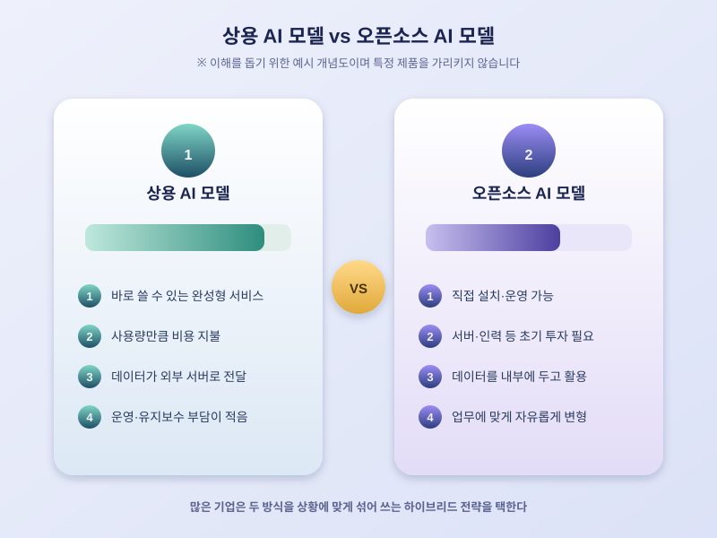

# 오픈소스 AI 모델 경쟁 심화, 국내 기업들의 대응 전략은

  

최근 AI 업계에서는 누구나 가져다 쓸 수 있는 오픈소스, 혹은 오픈웨이트 AI 모델들이 빠른 속도로 성능을 끌어올리며 화제가 되고 있습니다. 한동안은 소수의 대형 기업이 내놓는 상용 모델이 압도적인 격차를 유지한다는 인식이 강했지만, 최근에는 그 격차가 눈에 띄게 좁혀지고 있다는 평가가 늘고 있습니다. 이런 흐름은 단순한 기술 경쟁을 넘어, 기업들이 AI를 도입하는 방식 자체를 바꿔놓고 있다는 점에서 주목할 만합니다.

오픈소스 모델의 강점은 누구나 내부를 들여다보고 자신의 환경에 맞게 변형할 수 있다는 점입니다. 과거에는 외부 상용 서비스를 그대로 가져다 쓰는 것이 현실적인 선택이었지만, 이제는 자체 서버에 모델을 올려 운영하거나 특정 업무에 맞게 추가로 학습시키는 방식도 점점 보편화되고 있습니다. 비용 구조를 직접 통제할 수 있다는 점, 데이터를 외부로 내보내지 않아도 된다는 점이 특히 보안과 비용에 민감한 기업들에게 매력적으로 다가옵니다.

  

물론 오픈소스 모델을 도입한다고 해서 모든 고민이 끝나는 것은 아닙니다. 모델을 직접 운영하려면 서버와 인력, 유지보수 역량이 필요하고, 계속 쏟아지는 최신 모델을 따라가며 업데이트하는 것도 쉬운 일이 아닙니다. 그래서 많은 기업은 상용 모델과 오픈소스 모델을 상황에 맞게 섞어 쓰는 하이브리드 전략을 택하고 있습니다. 민감한 내부 데이터를 다루는 업무에는 자체 운영 모델을, 범용적인 업무에는 외부 상용 서비스를 쓰는 식입니다.

국내 기업과 스타트업들도 이런 흐름에서 예외가 아닙니다. 글로벌 오픈소스 모델을 가져와 한국어와 업무 특성에 맞게 손보는 시도가 이어지고 있고, 일부는 자체적으로 모델을 공개하며 생태계 조성에 뛰어들고 있습니다. 앞으로 AI를 도입하려는 기업이라면, 어떤 모델을 쓰느냐보다 어떤 조합으로 어떻게 운영할지를 먼저 고민하는 것이 더 중요한 질문이 될 것으로 보입니다.

※ 이 초안은 AI가 생성했습니다. 게시 전 수치·정책 내용의 사실관계를 반드시 확인하세요.
