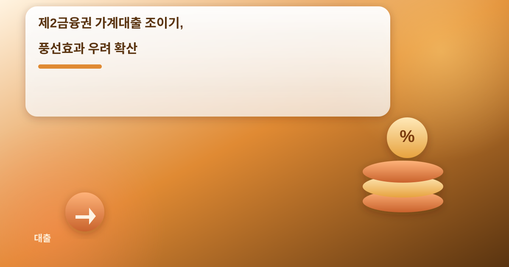
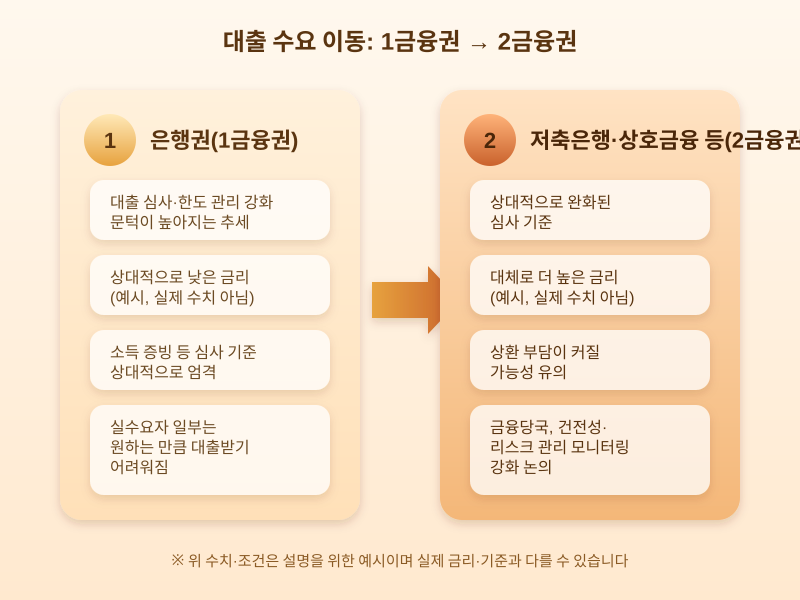

# 제2금융권 가계대출 조이기, 풍선효과 우려 확산

  

최근 은행권에서는 가계대출 총량을 관리하기 위한 심사 강화와 한도 조정이 계속되고 있습니다. 1금융권 문턱이 높아지자, 상호금융이나 저축은행, 캐피탈 같은 제2금융권으로 대출 수요가 옮겨가는 이른바 풍선효과 우려가 다시 고개를 들고 있습니다. 한쪽을 조이면 다른 쪽이 부풀어 오르는 이 현상은 가계부채 관리 정책이 반복적으로 맞닥뜨리는 숙제이기도 합니다.

제2금융권으로 수요가 이동하는 이유는 단순합니다. 은행권에서 원하는 만큼 대출을 받기 어려워진 실수요자들이 상대적으로 심사 기준이 느슨한 곳을 찾아 나서는 것입니다. 특히 자영업자나 소득 증빙이 까다로운 차주, 급하게 자금이 필요한 가구일수록 이런 흐름에 노출되기 쉽습니다. 문제는 제2금융권 대출이 대체로 은행권보다 금리가 높고, 상환 조건도 상대적으로 부담스러운 경우가 많다는 점입니다.

  

이런 흐름이 길어지면 당장의 자금 문제는 해결되더라도, 중장기적으로는 이자 부담이 눈덩이처럼 커질 위험이 있습니다. 특히 여러 금융권에 걸쳐 대출을 나눠 받는 경우, 전체 상환 부담을 한눈에 파악하기 어려워지는 점도 유의해야 합니다. 금융당국도 이런 풍선효과를 의식해 제2금융권의 대출 건전성과 리스크 관리를 함께 들여다보겠다는 입장을 밝히고 있으며, 필요 시 보완 대책을 검토하겠다는 신호도 나오고 있습니다.

연말을 앞두고 자금 계획을 세우는 입장이라면, 단순히 어디서 더 쉽게 대출을 받을 수 있는지보다 전체 상환 능력과 금리 조건을 꼼꼼히 비교하는 자세가 필요합니다. 특정 금융권의 문턱이 낮다는 이유만으로 성급하게 결정하기보다, 여러 상품의 금리와 조건을 비교해보고 본인의 상환 계획에 맞는 선택을 하는 것이 중요합니다. 정책 방향 역시 특정 권역을 조이는 데서 끝나지 않고, 전체 가계대출 구조를 함께 살피는 방향으로 나아갈 필요가 있어 보입니다.

※ 이 초안은 AI가 생성했습니다. 게시 전 수치·정책 내용의 사실관계를 반드시 확인하세요.
