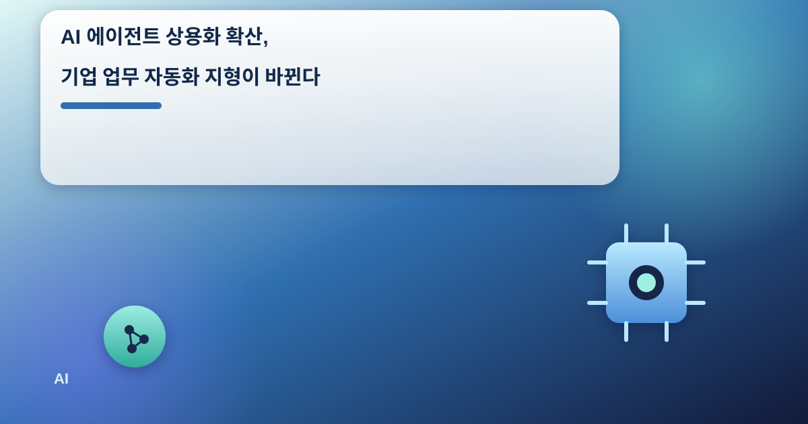
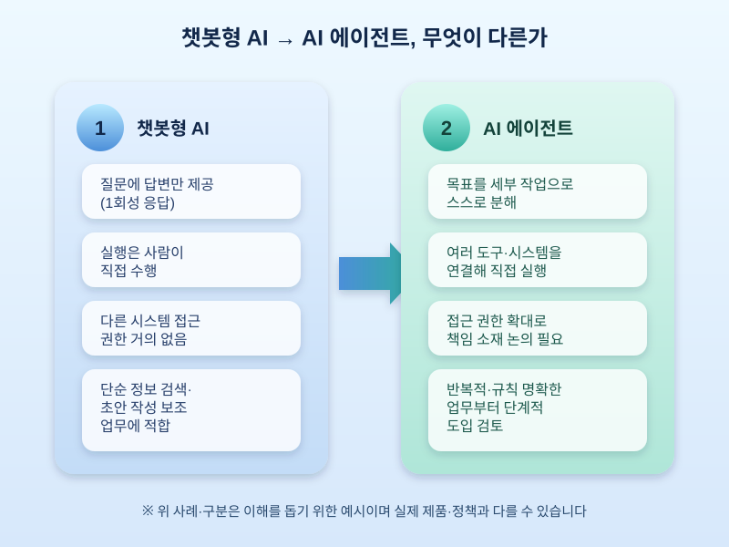

# AI 에이전트 상용화 확산, 기업 업무 자동화 지형이 바뀐다

  

최근 들어 단순히 질문에 답하는 챗봇을 넘어, 스스로 작업을 계획하고 실행하는 AI 에이전트에 대한 관심이 빠르게 커지고 있습니다. 국내외 주요 기업들이 이메일 작성이나 자료 검색을 넘어 보고서 초안 작성, 일정 조율, 간단한 데이터 처리까지 맡기는 사례를 속속 선보이면서, AI 에이전트는 더 이상 먼 미래의 이야기가 아니라 당장의 업무 환경에 들어오고 있는 변화로 받아들여지고 있습니다.

기존 챗봇형 AI와 에이전트형 AI의 가장 큰 차이는 '수행 범위'에 있습니다. 챗봇은 사용자가 묻는 말에 답을 주는 데 그치지만, 에이전트는 주어진 목표를 이루기 위해 여러 단계의 작업을 스스로 쪼개고, 필요한 도구나 시스템을 연결해 일을 끝까지 진행합니다. 예를 들어 회의 일정을 잡아달라는 요청 하나에 참석자 일정 확인부터 장소 예약, 초청장 발송까지 이어지는 과정을 사람의 개입 없이 처리하는 식입니다. 이런 특성 때문에 기업들은 반복적이고 규칙이 비교적 명확한 업무부터 에이전트 도입을 검토하는 경우가 많습니다.

  

다만 도입 속도가 빨라지는 만큼 우려의 목소리도 함께 커지고 있습니다. 에이전트가 여러 시스템에 접근 권한을 갖게 되는 구조이다 보니, 잘못된 판단이나 오류가 발생했을 때 책임 소재를 어떻게 가릴지에 대한 논의가 아직 충분히 정리되지 않았습니다. 또한 에이전트가 처리한 결과를 사람이 최종적으로 검증하는 절차를 어디까지, 어떻게 둘 것인지도 기업마다 다르게 접근하고 있는 상황입니다.

결국 AI 에이전트는 '사람을 대체하는 도구'라기보다 '반복 업무의 부담을 줄여주는 동료'로 자리잡아가는 흐름으로 볼 수 있습니다. 당장 모든 업무를 맡기기보다는, 실수의 위험이 적고 검증이 쉬운 영역부터 단계적으로 적용 범위를 넓혀가는 것이 현실적인 접근일 것입니다. 앞으로 에이전트 도입이 늘어날수록, 권한 설정과 검증 절차를 어떻게 설계하느냐가 기업의 실질적인 경쟁력을 가르는 요소가 될 가능성이 큽니다.

※ 이 초안은 AI가 생성했습니다. 게시 전 수치·정책 내용의 사실관계를 반드시 확인하세요.
