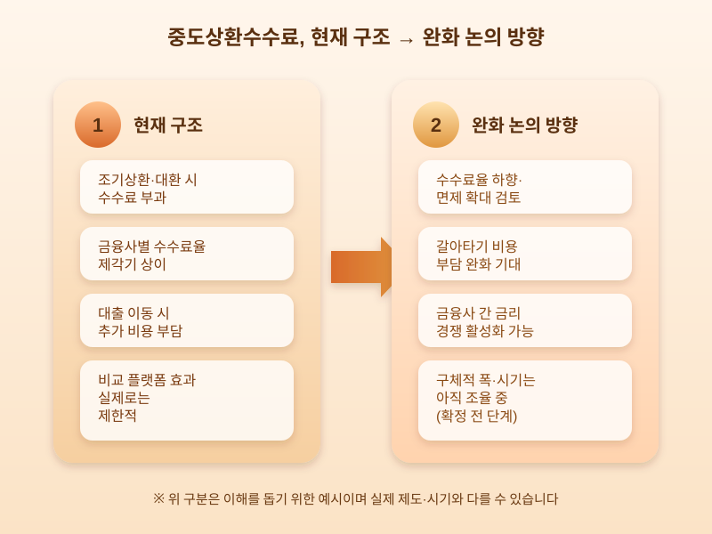

# 중도상환수수료 완화 논의, 대출 갈아타기 부담 줄어드나

  

대출을 받은 뒤 더 낮은 금리로 옮기고 싶어도 중도상환수수료 때문에 망설인 경험, 한 번쯤 있으실 겁니다. 최근 금융당국이 중도상환수수료 체계를 다시 들여다보겠다는 신호를 보내면서, 대출 갈아타기를 고민하는 차주들의 관심이 커지고 있습니다.

중도상환수수료는 대출 받은 지 일정 기간 안에 원금을 조기 상환하거나 다른 금융사로 옮길 때 부과되는 비용입니다. 금리를 책정한 금융사가 예상보다 빠른 상환으로 생기는 손실을 보전하려는 장치입니다. 다만 대출 이동을 막는 걸림돌로 지목되면서, 수수료율을 낮추거나 면제 조건을 넓히는 논의가 꾸준히 제기되어 왔습니다.

  

논의가 다시 불거진 배경에는 대출 갈아타기 서비스 확산이 있습니다. 비교 플랫폼으로 손쉽게 금리를 비교할 수 있지만, 수수료가 실질적인 진입장벽이라는 지적이 많았습니다. 수수료가 완화되면 차주 부담이 줄고 금리 경쟁도 활발해질 수 있지만, 금융사 수익에 영향을 줄 수 있어 폭은 조율이 필요합니다.

시행 시기나 조정 폭이 확정되지 않은 만큼, 갈아탈 계획이라면 현재 수수료 조건을 먼저 확인하는 것이 중요합니다. 금융사별로 면제 조건과 감면 구간이 다른 만큼, 금리뿐 아니라 수수료 구조까지 따져보는 습관이 필요합니다.

※ 이 초안은 AI가 생성했습니다. 게시 전 수치·정책 내용의 사실관계를 반드시 확인하세요.
